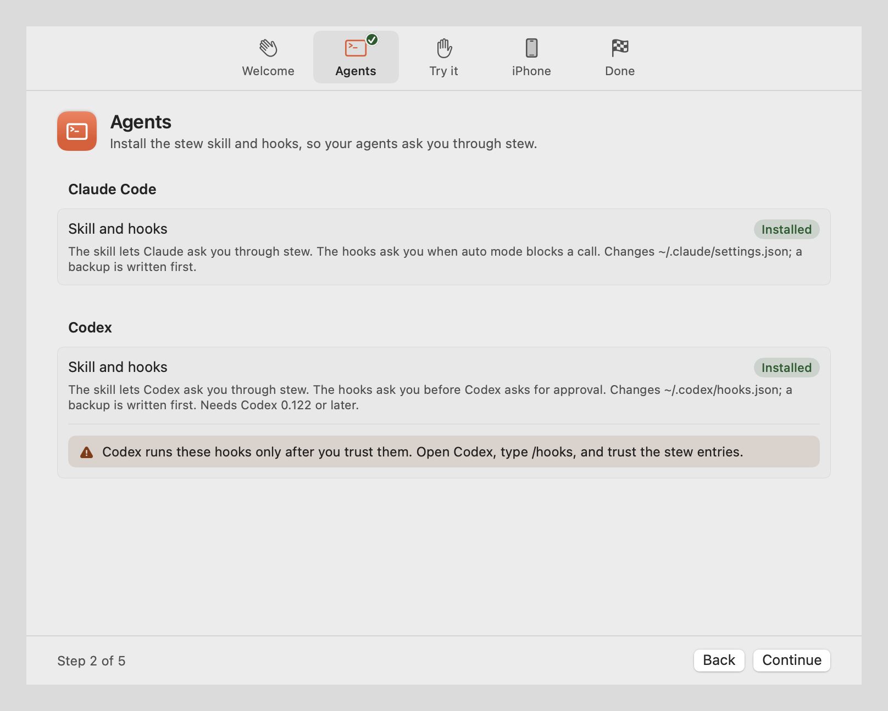
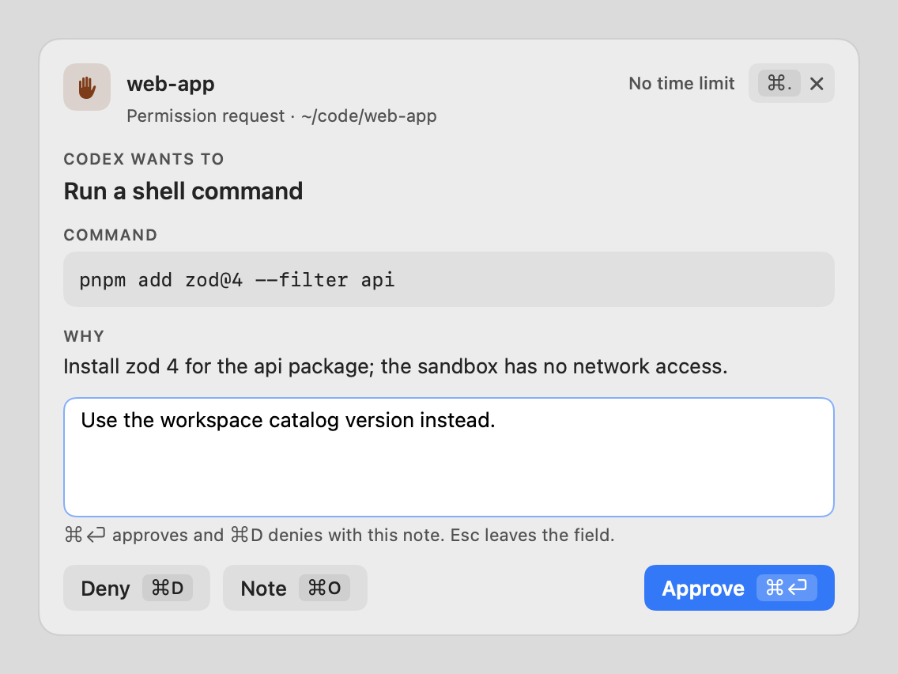
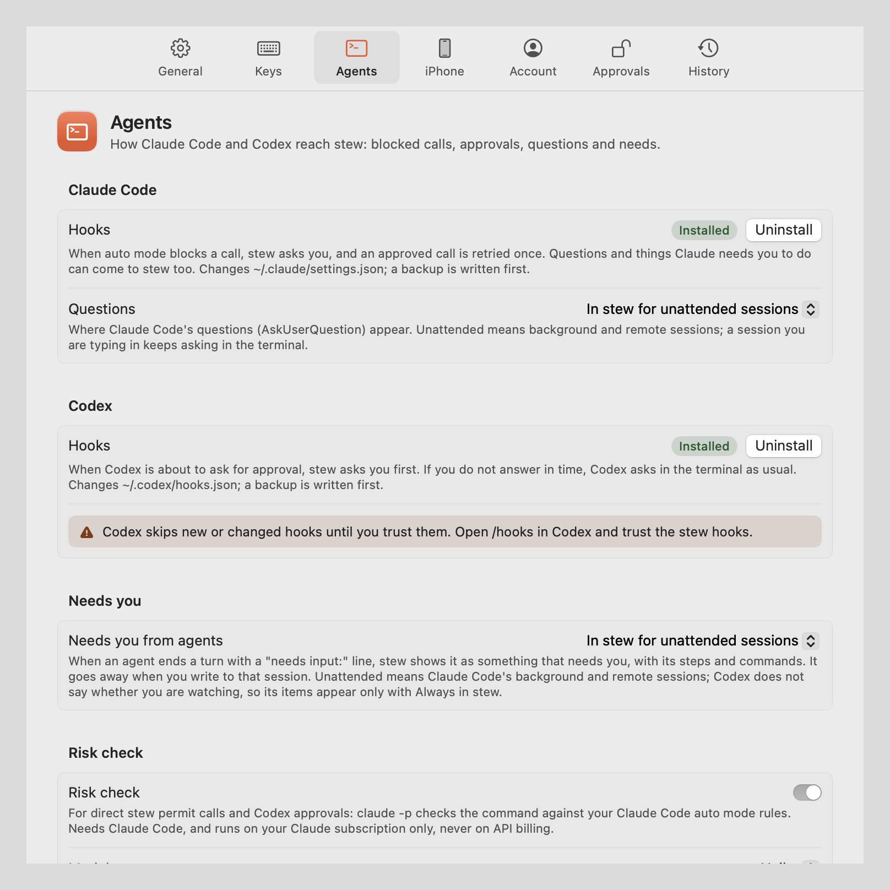
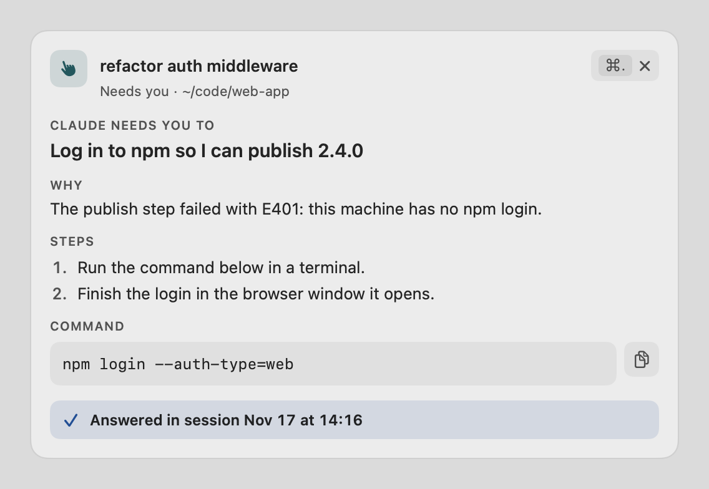
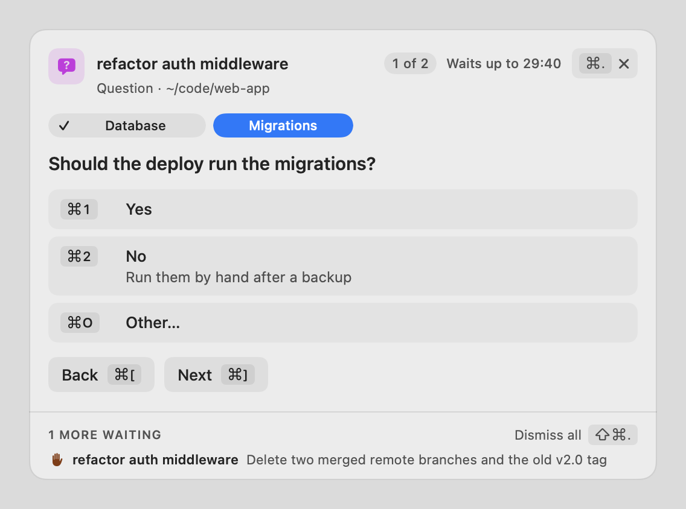
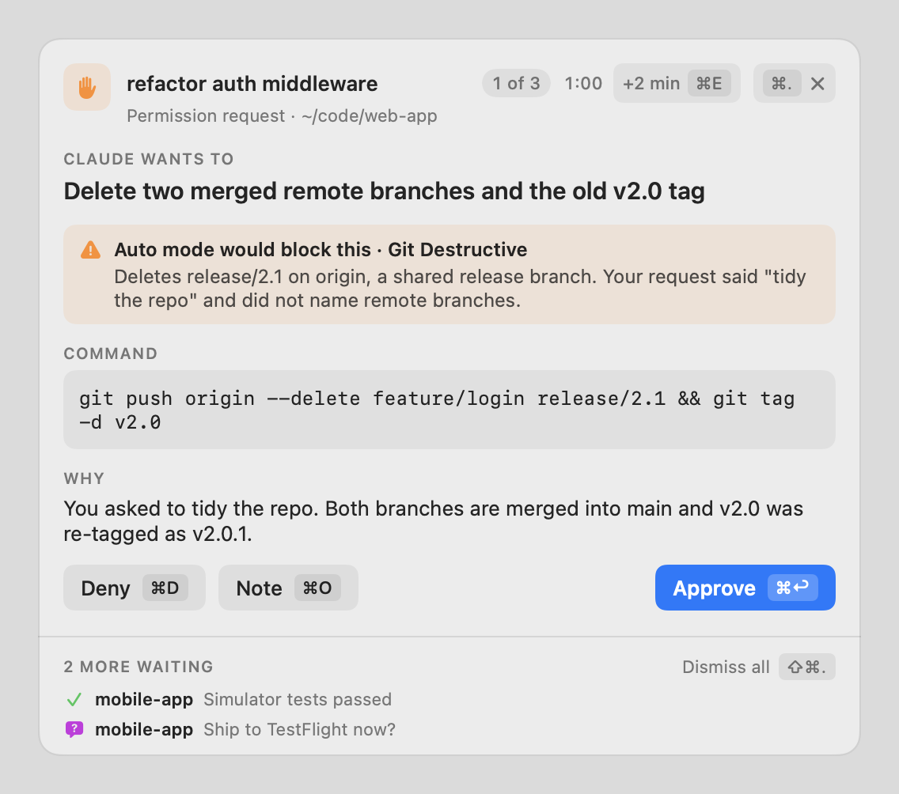
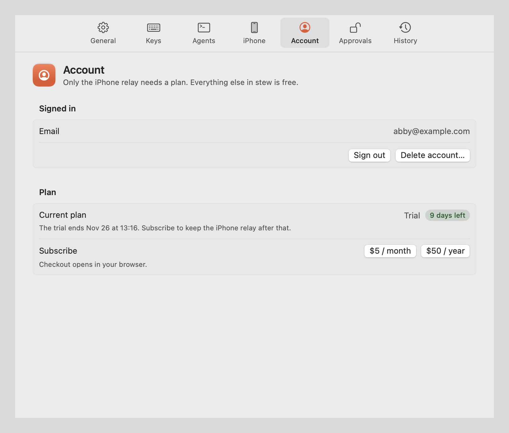

# stew

A macOS panel that lets Claude Code and Codex ask you for permission, ask you a question or tell you something, without taking keyboard focus from what you are typing.


- **Auto mode, with you as the fallback.** Claude Code's auto mode decides as usual. When it blocks a call, stew asks you. Approve, and Claude retries that exact call. You can also allow it for an hour, or for good, without being asked again.
- **Codex approvals, in stew first.** When Codex is about to ask for approval, stew asks you. Approve or deny with a note; if you don't answer in time, Codex asks in the terminal as usual.
- **Permission, questions, notifications.** Claude and Codex can call `stew` themselves: a permission request with the exact command and the reason, a question in the same format as Claude Code's AskUserQuestion tool, or a notification.
- **Needs you.** When Claude is stuck on something only you can do (log in, buy, approve in a web page, plug something in), stew shows the steps, the commands to copy and the links to open. It stays open until it is done, with a count in the menu bar.
- **Safe while you type.** Nothing answers on plain keys, Space or Return. Every answer is ⌘ plus a key, and only while a panel is visible.
- **Every session in one place.** Each panel names the session it comes from. Several requests queue as "1 of N". You can always dismiss.
- **Nobody waits forever.** You get 1 minute per request by default. If you don't answer, Claude is told you did not respond in time, so it can go another way. ⌘E gives you more time.
- **In the menu bar.** The stew icon counts what waits for you. A click shows the open needs items and your requests, with the selected one beside them as the panel showed it, so you can still answer one that timed out; a right-click opens the menu with History and Settings. Both pause stew while you are away: for an hour or two, until the morning, or until you are back at the Mac.

## Requirements

- macOS 14 or later
- [Claude Code](https://code.claude.com), for its skill and auto mode hooks, and for the risk check (or Codex for the risk check)
- [Codex](https://learn.chatgpt.com/docs/codex/cli) 0.122 or later, for its skill and approval hooks (0.129 or later asks you to trust new hooks in `/hooks`; see [Codex](#codex-approvals-in-stew))
- To build from source: a Swift 6 toolchain (Xcode 16 or later, or the Command Line Tools: `xcode-select --install`)

## Install

```bash
brew trust --cask koode/apps/stew && brew install --cask koode/apps/stew
```

Homebrew loads casks from a tap other than its own only after you trust them, hence `brew trust` first. This installs `/Applications/Stew.app`, links the `stew` command and its shell completion, starts the daemon as the LaunchAgent `nl.koode.stew` and installs the Claude Code skill if `~/.claude` exists and the Codex skill if `~/.codex` exists (the cask runs `stew setup`). stew then updates itself; `brew upgrade` leaves it alone unless you pass `--greedy`. To also ask in stew when Claude Code's auto mode blocks a call, or before Codex asks for approval:

```bash
stew hooks install                 # Claude Code
stew hooks install --agent codex   # Codex; then trust the hooks in Codex's /hooks
```

`brew uninstall --cask stew` stops the daemon and removes the app, but keeps the hooks, the skill and stew's data; run `stew hooks uninstall` first, or add `--zap` to remove all of it.

### No Homebrew?

```bash
curl -fsSL https://releases.stewcli.com/install.sh | bash
```

To also ask in stew when auto mode blocks a call (add `--agent codex` for Codex's hooks, or `--agent all` for both):

```bash
curl -fsSL https://releases.stewcli.com/install.sh | bash -s -- --with-hooks
```

The script downloads the latest release and checks it before it changes anything: the size and SHA-256 from the release manifest, and a code signature from Koode's Developer ID that Apple notarized. It then installs:

- `~/Applications/Stew.app`: the daemon and the command line tool. No admin rights needed.
- `~/.local/bin/stew`: a link to the tool inside the app.
- The LaunchAgent `nl.koode.stew`, which starts the daemon at login.
- The Claude Code skill in `~/.claude/skills/stew`, if `~/.claude` exists, and the Codex skill in `~/.agents/skills/stew`, if `~/.codex` exists.
- Shell completion: `~/.config/fish/completions/stew.fish` when fish is installed, and `_stew` in a zsh folder that needs no `.zshrc` change (a writable `site-functions` folder on your fpath, such as Homebrew's; otherwise `~/.zsh/completions`, and the installer prints the one `fpath` line to add). `stew completions install` redoes it, for example after you install Homebrew.

Other options: `--agent claude|codex|all` (with `--with-hooks`), `--no-skill`, `--no-completions`, `--bin-dir DIR`, `--app-dir DIR`. An older install with a plain binary at `~/.local/bin/stew` is replaced in place, and the hooks keep working because they call that path.

Moving to Homebrew later works without uninstalling first: the cask removes the completion files the script wrote, `stew setup` points `~/.local/bin/stew` at the new app (so the hooks keep working) and names the old `~/Applications/Stew.app`, which you can then delete.

`stew setup` is the per-user part of both installs, for a Stew.app that is already in place. Run it again after you move the app, or to repair the LaunchAgent: `stew setup [--with-hooks [--agent claude|codex|all]] [--no-skill] [--no-completions] [--bin-dir DIR]`.

### From source

Clone this repository, then from its folder:

```bash
./install.sh                 # Stew.app, background daemon, Claude Code skill
./install.sh --with-hooks    # also: ask in stew when auto mode blocks a call
```

The script builds Stew.app from source and installs the same layout. Run it again to update.

Check that it works:

```bash
stew notify "stew works" --body "Close this with ⌘. or ⌘↩"
```

### The setup window

The first time stew starts with no hooks installed for any agent, it opens a setup window, without taking the keyboard from the app you are in. It walks through five steps, each of which you can skip:

1. **Welcome:** what stew does.
2. **Agents:** whether Claude Code and Codex are on this Mac, and one Install button per agent for its skill and hooks (the same as `stew setup` and `stew hooks install`). For Codex it reminds you to trust the hooks in Codex's `/hooks`.
3. **Try it:** shows a sample permission request in the panel, which answers nothing to any agent, and lists your keys.
4. **iPhone:** whether you are signed in and have a paired iPhone, with buttons to Settings → Account and Settings → iPhone.
5. **Done:** where the menu bar icon is, how to reopen Settings and this window, and [stewcli.com/help](https://stewcli.com/help).



Closing the window, at any step, sets `"setup": {"completed": true}` in the config, so it does not open by itself again. Until then, opening Stew.app opens it instead of Settings. Reopen it any time with Set up stew… in the menu bar menu or in Settings → General.

### Let your agent set it up

Open Claude Code or Codex in this folder and paste:

> Set up stew for me by following docs/AGENT_SETUP.md. Ask me before you change any settings.

[docs/AGENT_SETUP.md](docs/AGENT_SETUP.md) gives the agent the checks, the two questions to ask you, the install command and the steps to verify.

## How agents use it

stew works with Claude Code and Codex. Both use the skill to call stew themselves (permission requests, questions, typed answers, notifications and needs items), and the panel names the agent that asks: "Claude wants to", "Codex wants to". The hooks differ, because the agents do: Claude Code's hooks catch the calls its auto mode blocks, and Codex's hooks catch its approval prompts.

### When auto mode blocks a call

This is Claude Code's. With `--with-hooks`, Claude Code hooks are added to `~/.claude/settings.json` (a backup is written first): one for calls auto mode blocks, one for the prompts auto mode leaves to you, one that lets an approved retry through, one for questions, two for things Claude needs you to do, and one that passes on late answers (see below).

1. Auto mode reviews a call as usual. If it allows the call, stew never sees it.
2. If auto mode blocks it, the `PermissionDenied` hook shows the call in stew: the command, auto mode's category for it, and Claude's last message as the reason. Auto mode tells only the category, so stew's own risk check (see below) then adds what in the call is risky, such as "drops every database ending in _pend, which you did not ask for", and marks that part of the command. This check only informs: it does not change how a blocked call is approved.
3. You approve (⌘↩), deny (⌘D, optionally with a note for Claude), or dismiss (⌘.). If the time to answer runs out, Claude is told you did not respond in time; you can still answer it later from History (see Late answers).
4. On approval, stew tells Claude Code that Claude may retry. The `PreToolUse` hook lets that identical call through once. A changed call goes back to auto mode.

**Allow more…** (⌘G) skips the question next time:


| You pick | For 1 hour (⌘↩) | Always (⇧⌘↩) |
|---|---|---|
| This command, or a prefix such as `npm run deploy *` | stew lets matching commands through | Added as `Bash(...)` to the project's `.claude/settings.local.json`, so Claude Code enforces it |
| Auto mode's category, such as "Destructive or Unwanted Actions" | stew approves blocked calls in that category for this project | Same, until you revoke it |

- Approvals apply to one project: the git root of the session's folder.
- stew's own approvals never match chained commands (`&&`, `;`, `|`, redirects, `$(…)`).
- Secrets in a command are shown as `••••` (with a button to reveal them) and become `*` in any saved rule.
- `stew approvals` opens a window that lists every standing approval, with Revoke.

### When Claude Code asks in the terminal

Auto mode still leaves a few calls to you in Claude Code's own prompt: a call that an `ask` rule in your settings covers, and a shell removal that could delete far more than intended, such as `rmdir "$R/$dir"` while `$R` might be empty. For such a removal, the prompt blocks the call after two minutes, so an unattended session keeps working.

The `PermissionRequest` hook shows these calls in stew at the same time, with Claude's description of the call and Claude's last message as the reason. Whichever you answer first decides: Approve or Deny in stew answers Claude Code's prompt, and an answer in the terminal closes the request in stew. A shell call in auto mode gets 1:55 in stew, so stew's time runs out just before Claude Code blocks the call. When stew's time runs out, nothing is decided and Claude Code's prompt stays open.

What hooks cannot change:

- A **hard deny** rule (such as Data Exfiltration) is meant to block even when you ask. stew asks for ⇧⌘↩ to approve once and offers no standing approvals.
- **Protected paths** (`.git`, `.claude`, shell profiles) stay blocked even with an allow rule.
- Denials without a verdict ("Classifier unavailable") cannot be retried, so stew does not ask.

### Codex: approvals in stew

`stew hooks install --agent codex` (or `--with-hooks --agent codex` at install) adds hooks to `~/.codex/hooks.json` (`$CODEX_HOME/hooks.json` when you set that), next to any hooks of your own, and writes a backup first. stew writes `hooks.json` rather than inline `[hooks]` tables in `config.toml`, which stays yours. If `config.toml` also has inline hooks, Codex runs both and warns at startup.

1. When Codex is about to ask for approval (a command outside the sandbox, a file edit through `apply_patch`, an MCP tool call), its `PermissionRequest` hook shows the request in stew: what Codex wants to do, the command or patch, and Codex's own reason for asking when it gives one.
2. Approve (⌘↩) and Codex goes ahead without its own prompt. Deny (⌘D, optionally with a note) and Codex gets "The user denied this in stew", with your note.
3. If the time to answer runs out, you close the panel, or stew is not running, stew decides nothing and Codex shows its own approval prompt in the terminal. Answer it there; such a request is not answered late from History.
4. The `Stop` and `UserPromptSubmit` hooks do what they do for Claude Code: needs items from a `needs input:` line, and late answers to `stew` calls from that session.



**Trust the hooks in Codex.** Codex runs a new or changed hook only after you review and trust it ([Codex hooks](https://learn.chatgpt.com/docs/hooks)). After installing, open `/hooks` in Codex and trust the stew hooks. Codex asks again when a hook changes, for example after the path to stew changes. `stew hooks status --agent codex` reminds you, and warns when `[features] hooks = false` in `~/.codex/config.toml` turns all hooks off.



What Codex does not have, so stew does not do for it: auto mode and its retry after a block, standing approvals (Allow more…), and the AskUserQuestion tool. Codex does not say whether anyone is at the terminal either, so its needs items appear only with "Needs you from agents" set to Always in stew. Codex needs 0.122 or later for `PermissionRequest` hooks; versions before 0.129 run hooks without the trust step.

When Codex runs `stew` from its sandbox, the sandbox may keep it from reaching stew's socket. Codex then asks for approval to run it outside the sandbox, which goes through the hook like any other approval. To skip that, allow `stew` in a Codex [rule](https://learn.chatgpt.com/docs/agent-configuration/rules).

### Questions in stew

Claude Code's own question tool (AskUserQuestion) can show in stew too, through a third hook. By default this happens only in **unattended** sessions: background jobs and remote sessions, where nobody is at the terminal to answer. A session you are typing in keeps asking in the terminal. Change it in `stew settings` → Agents → Questions, or with `"routeQuestions"` in the config: `"unattended"`, `"always"` or `"never"`.

The answer goes back to Claude as if you had answered in the terminal. If the time to answer runs out, or you close the question, Claude is told so and continues with a safe choice. If stew is not running, the terminal asks as usual.

### Needs you: things only you can do

What Claude sessions wait on most is something only you can do: log in, buy more credits, approve a build in a web page, plug in a phone. stew shows it as a **Needs you** panel with what Claude needs, why, numbered steps, each command in a box with a copy button, and links that open in your browser.


- **Done** (⌘↩) tells Claude it is done, optionally with a note (⌘O). **Decline** (⌘D) tells Claude you will not do it.
- Claude can name the Done button after the state you reach ("Signed in", "Bought it") and offer up to 3 other answers ("Can't sign in", "Use another account") on ⌘1 to ⌘3. Each one ends the item and tells Claude which you picked, with your note.


- **Not now** (⌘.) keeps it open for later. It has no time limit.
- Permission requests and questions always go first. A needs item shows when nothing else is waiting.
- The menu bar icon counts open items. Its popover and its menu list each item and open it in the panel.
- When you come back to the Mac, the notice counts what still needs you ("2 things need you"), and an item you put off with Not now shows once more.
- When Claude or the session ends an item that has been on screen for less than 5 seconds, it stays until it has shown 5 seconds in all, closed: how it ended (such as "Answered in session") takes the place of its buttons, as in History, and ⌘. closes it sooner. So a panel never flashes by before you can read it. An item that ends while it still waits behind a request goes at once.
- Open items survive a restart. They end when you press Done or Decline, when Claude runs `stew needs resolve ID` after it sees the thing got done, or (for items from the hook below) when you write to that session.



Claude or Codex can make one with `stew needs` (the skill tells it when). With the hooks, the agent also makes one by itself: when a turn ends with a line that starts with `needs input:`, the `Stop` hook turns that line into the title, a numbered list after it into the steps, code blocks in the message into commands, and up to 4 web addresses outside the code blocks into links. A session has at most one of these at a time, and none while it has an open item from `stew needs`. The `UserPromptSubmit` hook clears it as soon as you send that session a message, and a later turn that ends without a `needs input:` line clears it too (Moved on in the history). Claude Code also runs `UserPromptSubmit` for scheduled tasks, background agents reporting back and messages from other sessions, so those clear the item as well. By default this happens only in unattended Claude Code sessions (background and remote); Codex does not say whether anyone is watching, so for Codex it needs `"always"`. Change it in `stew settings` → Agents → "Needs you from agents", or with `"autoNeeds"` in the config: `"unattended"`, `"always"` or `"never"`.

### Typed answers

When Claude needs one value it cannot pick from a list, such as a domain, a name, a verification code or a password, it asks with `stew input`. The panel shows the question, why, and one field.


- The field shows what it holds but does not take the keyboard. Click it or press ⌘O to type; Esc leaves it. The clock pauses while the field is open, as for a note, and stops once you type (see Time to answer).
- ⌘↩ sends, also from inside the field. Plain Return never sends: in a one-line field it does nothing, and with `--multiline` it adds a line.
- With `--pattern`, ⌘↩ and Send stay off until the whole answer matches, and a line under the field says what form it needs: the `--format` text ("Expected: 6 digits") when Claude gave one, else the pattern itself. `--format` without `--pattern` is refused.
- ⌘. dismisses it without an answer. A plain input that timed out can be answered later from the History, like a question.

**Secrets.** With `--secret` the field shows dots (always 8 until you focus it, so they never tell the length), and stew never writes the answer anywhere: not to the history (the row says a secret was entered), not to its logs or files. You can also type it in the stew app on a paired iPhone (never in a notification), and the Mac treats it the same way. Two more choices show, also on your iPhone: **Give me 5 min** (⌘5) adds 5 minutes, and **I'll enter it later** (⌘L) lets Claude go on now with `"status":"later"`. You then enter it in the History tab (select it; Missed only lists it, and the notice when you come back counts it), and it reaches the session as a late answer. A secret that timed out can be entered late the same way. Once entered, the daemon keeps the secret in memory only; if stew stops or restarts before the session picks it up, the secret is gone and Claude is told to ask again.


### The skill

The skill tells agent sessions to use stew when you are probably not watching the terminal: background jobs, long tasks, decisions that block progress. Claude Code reads it from `~/.claude/skills/stew`, Codex from `~/.agents/skills/stew`. Edit its `SKILL.md` to change when sessions use it; `stew setup` writes it again.

### Calling it directly

```bash
# Permission. Exit 0 approved, 1 denied, 2 dismissed, 3 timeout.
stew permit --action "Delete the build cache" --command "rm -rf .build" --reason "It holds objects from an old toolchain."

# Notification. Returns at once; the panel stays until closed.
stew notify "Tests passed" --body "212 of 212" --level success

# Question, in AskUserQuestion format.
stew ask --json '{"questions":[{"question":"Which database?","header":"DB","multiSelect":false,
  "options":[{"label":"Postgres","description":"Relational"},{"label":"SQLite","description":"Embedded"}]}]}'

# One typed answer. Exit 0 answered, 2 dismissed, 3 timeout, 5 later (secrets only).
stew input "Which domain should the staging site use?" --why "The DNS record needs it." \
  --placeholder staging.example.com --pattern '[a-z0-9.-]+\.[a-z]{2,}' --format "a domain name"
#   {"id":"…","status":"answered","text":"staging.example.com"}
#   --default TEXT prefills the field, --multiline lets Return add a line,
#   --secret masks it and keeps the answer out of every file.

# Something only the user can do. Returns at once with {"status":"shown","id":"…"}.
stew needs "Log in to npm so I can publish 2.4.0" --why "The publish failed with E401." \
  --step "Run the command below" --step "Finish the login in the browser" \
  --command "npm login --auth-type=web" --link https://www.npmjs.com/settings/tokens
#   --wait blocks until Done ("done", with the note) or Decline ("dismissed");
#   --timeout SECONDS limits only that wait, and the item stays open.
#   --done LABEL names the Done button ("Signed in"), and --answer LABEL (up to 3)
#   adds other outcomes on ⌘1 to ⌘3. The answer then names the picked label:
#   {"answer":"Signed in","id":"…","status":"done"} or
#   {"answer":"Can't sign in","id":"…","status":"answered"}.
stew needs list [--json]       # the open items
stew needs resolve ID          # clear one once you can see it is done
```

Answers print as one JSON line. `stew --help` lists every command and flag.

### Time to answer

Permission requests, questions and inputs get 1 minute by default (`responseTimeout`). The clock starts when the request reaches the front of the panel, and it pauses while the note field or "Allow more…" is open, and while the pointer rests on the request's card (after half a second there, for at most 15 minutes per request; it runs again as soon as the pointer leaves, and the hard limit below still applies). ⌘E adds 2 more minutes (`extendBy`) as often as you like. When the time runs out, the answer is `"status":"timeout"` with a note telling Claude you may be away, that it should continue another way or ask again later, and that a late answer may still follow (see Late answers). `--timeout SECONDS` overrides the limit for one call, and `--timeout 0` turns it off.

Once you start answering a request, its clock stops for good: when you type into it (a note, an answer, an input's value), move between its questions (⌘] and ⌘[, or a click on a tab), pick an option that does not send the answer yet (one question of several, a multiple choice, a scope under "Allow more…"), or press ⌘↩ before it can be sent. The request then waits for you and is not sent to your iPhone. The panel shows "No time limit", or "Waits up to 29:40" when the caller has a hard limit (`maxWait`): Claude Code's hooks set one to stay inside Claude Code's own hook timeout, and stew cannot extend it.



While you answer one request, the ones that arrive meanwhile wait behind it, and their clocks do not run. When you answer or close it, the next one's clock starts fresh with the full time, or with what is left of its hard limit when that is less. A request whose hard limit runs out while it waits times out where it is, and Claude is told you were answering another request.



For a direct `stew permit`, a Codex approval and a call auto mode blocked, stew runs its own risk check: a small, fast model judges the command against the rules from `claude auto-mode config`, with your recent messages in the session and the `git status` of the session folder as context, so it can say which uncommitted work a command would lose. The verdict shows above the command after approximately 5 seconds, with the risky part of a longer command marked. Claude Code's real auto mode prompt is not public, so this check approximates it with the same rules.

**Which tool checks.** By default the agent that asks: Claude Code's requests go to `claude -p` (Haiku), Codex's to `codex exec` (`gpt-6-luna`). When that tool is not installed or not logged in, the other one checks; when neither can, the panel says "Risk check unavailable" and names what is missing. Pick one tool for every request under Settings ▸ Agents ▸ Risk check ▸ Check with, or with `classifier.backend` (`agent`, `claude` or `codex`). Without Claude Code there are no auto mode rules to read, so Codex checks against a short set of stew's own rules with the same categories (Data Exfiltration, Git Destructive and so on). Codex runs read-only with every tool turned off (no shell, no web search, no apps, MCP servers or hooks), no approvals and no saved session, from a fresh folder in the temporary folder that is removed afterwards. It does not read your `config.toml`, execpolicy rules, project `AGENTS.md` files or the skills catalog, and the check's own instructions replace Codex's built-in ones. Your global `~/.codex/AGENTS.md` (or `AGENTS.override.md`) still loads: Codex has no documented switch for it, and moving the Codex home would also move the login.

#### Severity


The same check also rates how bad the action is if it runs, and says in one line whether it can be undone. Severity is about what the action does, not how sensitive the data it touches is: you approve each action, so reading a secret on this Mac (a keychain lookup, an `.env` file, `op read`) is low or medium. It becomes high or critical when the action also sends the secret out, or uses it to do something that cannot be undone.

| Level | Examples | What changes |
|---|---|---|
| Low risk | Edit files in the repo, `git commit`, `rm -rf` of a build folder | Nothing |
| Medium risk | `git push`, `git reset --hard` (the reflog keeps the commits), installing a package | Nothing |
| High risk | `rm -rf` outside the project, a force-push to a shared branch, `DROP TABLE`, deleting cloud resources | The warning look, and 1 more minute to answer |
| Critical risk | Sending money or emails to customers, deleting production data or backups, publishing a release | The red look, Approve needs ⇧⌘↩ like a hard deny, and 1 more minute to answer |

The panel shows the level as a chip in the risk banner, with the reversibility line under the summary, such as "Can be undone with git reflog." or "Deletes files permanently; no undo." History and the menu bar popover show the level as a pill next to the outcome. On the iPhone, high and critical need an extra confirmation before Approve (see [docs/PHONE.md](docs/PHONE.md)). When the risk check is off or fails, there is no severity and nothing changes. Each rule is a setting under Settings ▸ Agents ▸ Risk check.

### History: what you missed

Every request is kept for 30 days (`historyDays`) once it ends: when, the session, the request, the command with secrets masked, how it ended, where you answered it (the Mac or an iPhone) and what the agent was told. The menu bar popover lists them on the left, newest first, with the title, the session and time, and the outcome and risk; the History tab in Settings shows the same. The newest request is selected when it opens and when you switch between All and Missed, and the count on Missed says how many it lists. Click a request, or after a click in the list use up and down, to select another. On the right, the selected request shows the way the panel showed it, with how it ended in place of the buttons, and below it when it was asked and ended and what Claude was told. A secret shows as dots: stew never keeps it. A request that ran out of time is **missed**; one you closed yourself is not. Missed only (and `stew history --missed`) also lists secrets you chose to enter later, labeled Enter later. A needs item is recorded when it ends: Done, Answered (one of its other answers), Dismissed (declined), Resolved by Claude (or Codex), Answered in session, or Moved on. For an item with answers of its own, the detail shows the one you picked. Not now is not an ending, so it is not recorded.

When you come back to the Mac after at least 2 minutes away and requests timed out meanwhile, stew shows one notice, "3 requests timed out while you were away", with **Open history** (⌘↩). The same notice counts secrets you chose to enter later ("1 secret to enter") and open needs items ("2 things need you"), and shows on its own when only those are open.

```bash
stew history                    # open the menu bar popover on the requests
stew history --missed           # the same, showing only missed requests
stew history --missed --json    # print them as a JSON array, for scripts
```

`stew history`, the menu's History… and Open history on the notice open the popover, also with the menu bar icon hidden: the icon then shows until the popover closes. Until you open the popover or History, the menu bar icon counts missed requests too, and its History… entry shows how many. The ones that were new keep a dot in the list until you select them.

For a missed call that auto mode blocked, the preview offers **Allow next time…**: the same choices as Allow more… (this command, a prefix or the category, for 1 hour or always) for that project.

The history is in `~/Library/Application Support/stew/history.jsonl` (mode 0600). To empty it, click the trash button above the list, in the popover or in Settings, then Clear. Missed requests can then no longer be answered late, but late answers you already gave still reach Claude.

### Late answers

A permission request, question or input that ran out of time can still be answered for 24 hours, and so can a secret you chose to enter later (Enter later in the history). Select it in the menu bar popover (or the History tab): the preview keeps the panel's buttons, without a time limit, and you answer it there as usual (approve or deny with a note, Allow more…, pick the options of the question, or type the answer). Selecting a request never answers it. After a click in the preview, the panel's keys work there too, while the popover (or the History window) has the keyboard; the list's keys only move the selection. Meanwhile the floating panel's keys pause, so they never answer a request you are not looking at; its buttons still work. The row then shows the late outcome, such as "Approved late", what Claude is told, and whether Claude has received it. A paired iPhone can answer such a request late too, for as long as the Mac runs: the answer goes the same way, and the phone shows "Sent as a late answer" (see [docs/PHONE.md](docs/PHONE.md)).

The answer goes to the Claude Code session that asked, through the hooks, at its next step:

| The session is | The answer arrives with |
|---|---|
| Working | The next tool call (`PreToolUse`), as context next to the tool result |
| About to finish | The end of the turn (`Stop`): Claude continues with the answer |
| Idle | Your next message (`UserPromptSubmit`), as context next to it |

- Each answer arrives once, and only in the session that asked. A subagent gets only its own answers; the main agent gets every answer of its session.
- A late approval of a call that auto mode blocked also lets the identical retry through once. Claude is told to retry it if it still needs it.
- Commands in what Claude reads have their secrets masked, as in the history.
- An answer that no hook picks up within 24 hours is dropped. Requests without a Claude Code session (a `stew permit` from your own shell) cannot be answered late.
- Delivery needs the hooks from this version: `stew hooks status` says "partly installed" for an older install, and `stew hooks install` updates it. The `Stop` delivery is a hook that runs in the foreground (only those can keep Claude going); it only reads `late-answers.json`, so it does not slow down the end of a turn.

Waiting requests and late answers are in `~/Library/Application Support/stew/late-answers.json` (mode 0600). A late secret is not: the file holds a placeholder, and the hook fetches the secret from the daemon's memory once, when it delivers the answer.

## On your iPhone

When a request stays open while you are away from your Mac, stew can send it to your iPhone as a notification you can answer: Approve (Face ID first on a locked phone), Deny, More time, a question's options, a typed reply to an input, or Done and the other answers on a needs item. A secret input is typed on the Mac or in the stew app's masked field, never in a notification; the notification offers Enter in app, Give me 5 min and I'll enter it later. The answer goes back to the Mac, end-to-end encrypted through a relay that cannot read it. It needs the stew iPhone app, which is distributed through TestFlight while stew is in beta. Pair a phone in `stew settings` → iPhone.

The iPhone relay is the one part of stew that needs a plan; everything else is free and works without an account. Sign in with your email in `stew settings` → Account (a link and a 6-digit code arrive by email) to start a free trial, subscribe or manage billing. [docs/PHONE.md](docs/PHONE.md) explains when requests are sent, the security model and the wire protocol.



## Keys

Every key is ⌘ plus one key, and works only while a panel is visible. Presses in the first 0.5 seconds after a panel appears are ignored, so a shortcut meant for another app cannot answer it.

| Keys | Action |
|---|---|
| ⌘↩ | Approve, OK on a notification, or Done on a needs item |
| ⌘D | Deny, or Decline a needs item |
| ⌘O | Open the note, "Other" or input field (the only thing that takes keyboard focus) |
| ⌘G | Allow more… on a call auto mode blocked |
| ⌘E | More time (+2 minutes) |
| ⌘1 to ⌘4 | Pick an option, or one of a needs item's other answers |
| ⌘↩ | Confirm a multi-select question, or send typed text. With a question still unanswered, the panel goes to it and says so |
| ⌘5 | Give me 5 min, on a secret input |
| ⌘L | I'll enter it later, on a secret input |
| ⌘[ / ⌘] | Previous or next question |
| ⌘. | Dismiss without answering, or Not now on a needs item |
| ⇧⌘. | Dismiss everything waiting (needs items get Not now) |
| ⇧⌘↩ | Approve past a hard deny, or Always in Allow more… |

The keys avoid ones you press while typing: deny is ⌘D (the macOS "Don't Save" key), not ⌘⌫. Dismiss is ⌘. (the macOS cancel key), not ⌘W. While a panel is visible these keys go to stew, so your terminal's ⌘D or ⌘1 waits until it closes.

While a field has the keyboard (a note, "Other" or an input), only ⌘↩ and ⇧⌘↩ go to stew. Every other key goes to the field, so ⌘C, ⌘V, ⌘A and ⌘Z edit the text as usual. Esc leaves the field, keeps what you typed and brings the other keys back, so Esc then ⌘D denies with your note.

Keys follow your keyboard layout, so "D" is the key that types D, also on Dvorak, Colemak or a remapped keyboard.

## Menu bar and pause

The stew icon in the menu bar is the app icon, or with Settings → General → Icon set to Monochrome, the pot alone in the menu bar's color. A count beside it says what waits for you: open needs items, and missed requests you have not seen in History yet. A blue dot means an update is waiting, and the icon turns grey (monochrome: faded) while stew is paused.

A click opens a popover. At the top: Pause stew (or Resume, or Cancel pause while Until I'm back counts down), Settings, and a waiting update. On the left: the open needs items, then your requests with All, Missed and Clear. On the right: the selected request as the panel showed it (see History). Pause stew offers the same choices as the menu. Clear asks first, then removes every request from the history; answers you already gave late still reach Claude. Click a needs item to open it in the panel, or a request to see it on the right, where you can still answer it late. Opening the popover does not take the keyboard from the app you are in; a click in it does, and closing it gives the keyboard back. A click anywhere else closes it. Opening it counts as seeing the missed requests in its list.

A right-click or Control-click opens the menu. It lists the open needs items, then History…, Settings…, Pause stew (or Resume stew), an update entry when there is one, and Hide menu bar icon.

**Pause** when you step away: permission requests, questions and inputs then time out at once, and Claude is told you paused stew and are away, and when stew resumes, so it can go another way. They are recorded as missed, so you can still answer them late from History. Notifications still show, and needs items wait in the menu bar until the pause ends. Resume ends a pause early and shows what timed out meanwhile. Settings → General shows the pause too.

The Pause stew submenu offers:

- **For 1 hour** and **For 2 hours**.
- **Until 08:00**: until the next morning hour, today while it is still ahead, else tomorrow (the menu then says "Until 08:00 tomorrow"). Set the hour in Settings → General → Pause until morning, or `"pauseMorningHour": 7`.
- **Until I'm back**: the menu counts down a minute ("Pausing in 0:45…", with Cancel pause), so moving the mouse right after choosing it does not end it. Then stew stays paused until the first keyboard or mouse input. Locking the screen begins the pause at once, and unlocking it ends the pause. stew reads only how long the Mac has been idle, so it needs no Accessibility permission.

```bash
stew pause                 # for 1 hour
stew pause 20              # for 20 minutes (at most 1440)
stew pause --until 08:00   # until the next 08:00 (also 8am, 8:30pm, 20:30)
stew pause --until-back    # after 1 minute, until the next keyboard or mouse input
stew resume                # end it now, or cancel Until I'm back before it begins
```

Hide the icon with Hide menu bar icon, Settings → General → "Show in menu bar", or `"menuBar": false`. It still shows while a needs item is open, and `stew settings` (or opening Stew.app) brings Settings back.

## Updates

stew updates itself. The daemon checks for a new version one minute after it starts and then once a day, and installs it when no request is open in the panel, then restarts. The first start of the new version shows "stew updated to 0.2.0", with a link to the release notes. Turn installing off in `stew settings` → General → "Install updates automatically", or with `"autoUpdate": false`: stew still checks, and shows one notice per new version with **Install now** (⌘↩) and **Later** (⌘.). The menu bar offers the install too.

```bash
stew version           # the version and build
stew update --check    # is there a newer version?
stew update            # install it now
```

A build from source (`./install.sh`) is not signed with Koode's Developer ID, so it never installs updates: `stew update --check` still reports a newer version, and Settings says to rebuild instead.

stew updates the app it runs from, wherever it is: `/Applications/Stew.app` from Homebrew, `~/Applications/Stew.app` from the script. If your user cannot write to that folder (a standard account and `/Applications`), stew reports the new version and tells you to run `brew upgrade --cask stew` instead.

An update is installed only when the download matches the size and SHA-256 in the release manifest, carries an Ed25519 signature from the stew release key, and the app inside is signed with Koode's Developer ID. Each step is logged to `~/Library/Logs/stew.log`.

| `stew update` exit code | Meaning |
|---|---|
| 0 | Up to date, or the update was installed |
| 10 | An update is available (`--check` only) |
| 11 | A newer version exists but needs a newer macOS |
| 12 | Downloaded and verified; installs as soon as no request is open |
| 20 | The check failed: network, server or an invalid manifest |
| 21 | The download was rejected: size, SHA-256, signature or code signature |
| 22 | Moving the new app into place failed; the old version stays |

## Configuration

Run `stew settings` for a settings window, or edit `~/.config/stew/config.json` directly. The window writes the same file. Every field is optional, and changes apply to the next request without a restart. `stew keys` shows the keys in effect and reports conflicts.


The window has seven panes, picked from its toolbar:

- **General:** pause, the menu bar icon, time to answer, more time, arming delay, position, look (solid or glass), sound, confetti, updates, and Set up stew… for the setup window.
- **Keys:** click a key and press the new combination.
- **Agents:** install or remove the Claude Code and Codex hooks, choose where questions and needs items appear, and set up the risk check, including which tool runs it.
- **iPhone:** pair and unpair iPhones, and choose when requests go to them (see [docs/PHONE.md](docs/PHONE.md)).
- **Account:** sign in, see the plan the iPhone relay needs, subscribe and manage billing (see [docs/PHONE.md](docs/PHONE.md#account)).
- **Approvals:** the same list as `stew approvals`.
- **History:** the same list and preview as the menu bar popover, in a bigger window (see History).

```json
{
  "chord": "cmd",
  "keys": { "approve": "return", "deny": "d", "dismiss": ".", "dismissAll": "cmd+shift+.",
            "other": "o", "submit": "return", "next": "]", "previous": "[", "grant": "g", "extend": "e",
            "enterSoon": "5", "enterLater": "l" },
  "optionKeys": ["1", "2", "3", "4"],
  "hardDenyExtra": "shift",
  "armDelay": 0.5,
  "responseTimeout": 60,
  "extendBy": 120,
  "routeQuestions": "unattended",
  "autoNeeds": "unattended",
  "sound": "Glass",
  "position": "top-right",
  "panelLook": "solid",
  "confetti": false,
  "autoUpdate": true,
  "historyDays": 30,
  "menuBar": true,
  "classifier": { "enabled": true, "backend": "agent", "model": "haiku", "codexModel": "gpt-6-luna",
                  "timeoutSeconds": 60, "recentUserMessages": 6,
                  "criticalNeedsStrongApprove": true, "highExtraTime": 60, "phoneConfirmation": "highAndCritical" }
}
```

- A bare key (`"d"`) joins `chord`. A full spec (`"ctrl+option+y"`) stands alone.
- Keys without Control, Option or Command are refused.
- Approve and submit may share a key, because they never show on the same panel. Other clashes are refused.
- `routeQuestions` is `unattended`, `always` or `never`: where Claude Code's own questions appear.
- `autoNeeds` is `unattended`, `always` or `never`: for which sessions a `needs input:` line at the end of a turn becomes a needs item.
- `responseTimeout` and `extendBy` are in seconds. `responseTimeout: 0` turns the time limit off.
- `position` is `top-right`, `top-center`, `top-left`, `bottom-right`, `bottom-center` or `bottom-left`. Dragging the panel sets it too: the panel snaps to the nearest of these on the display where you let it go.
- `display` is the display the panel opens on, by its display UUID. stew sets it when you drag the panel to a display. Without it, or while that display is not connected, the panel opens on the display with the pointer.
- `panelLook` is `solid` or `glass`. Glass puts macOS's Liquid Glass behind the panel, tinted so text stays readable over busy windows. It needs macOS 26 or later; older macOS keeps the solid panel.
- `sound` is a name from `/System/Library/Sounds` (such as `"Glass"`), or `""` for none.
- `confetti` shows a short burst of confetti where the panel was when you approve a request. It is off by default, and never plays when "Reduce motion" is on in macOS.
- `autoUpdate` installs new versions by itself (see Updates).
- `historyDays` is how many days of request history to keep.
- `menuBar` shows the stew icon in the menu bar. Off, it shows only while a needs item is open.
- `menuBarIcon` is `"color"` (the app icon, the default) or `"monochrome"` (the pot alone, in the menu bar's color like the system icons).
- `pauseMorningHour` is the hour, 0 to 23, that Pause stew → Until 08:00 ends at (8 by default).
- `setup.completed` is set when you close the setup window; until then it opens when stew starts with no hooks installed, and when you open Stew.app.
- `account.server` is the stew account service, `https://account.stewcli.com` by default.
- `phone.viewingCap` is the longest a request's clock stays paused while it is open in the stew app on a paired iPhone, in seconds (900 by default).
- `classifier` controls the risk check on direct `stew permit` calls and Codex approvals. `backend` is `agent`, `claude` or `codex`: which tool checks (see Risk check). `model` is Claude's model, `codexModel` Codex's; `claudePath` and `codexPath` point at a CLI that is not in the usual places. `criticalNeedsStrongApprove` asks for ⇧⌘↩ on a critical action. `highExtraTime` is the seconds added to the time to answer for high and critical actions (0 adds none). `phoneConfirmation` is `highAndCritical`, `critical` or `off`: which levels need the extra confirmation before the iPhone approves.

## Security model

- **stew never runs commands.** The agent runs them through its own tools, so Claude Code's or Codex's permissions, sandbox and transcript still apply.
- **One retry, one call.** An approval lets one identical call through, in the session that asked, within 15 minutes.
- **No API billing.** The risk check runs `claude -p` with no tools, no settings sources (so no hooks) and no saved session, or `codex exec` read-only with no tools, no user config, no hooks and no saved session. It runs only on a subscription login: API key variables are removed from its environment, and it refuses to run unless `claude auth status` reports a claude.ai login, or `codex login status` a ChatGPT login.
- **No self-approval.** The daemon accepts answers only from its own panel. Its test mode, which accepts simulated key presses on its socket, has to be turned on when the daemon starts, so a caller cannot approve its own request.
- **Signed updates only.** An update needs a valid Ed25519 signature from the stew release key and Koode's Developer ID code signature. The release server only serves the files.
- **Local files only.** The socket is `~/Library/Application Support/stew/stew.sock` (mode 0600). Approvals are in `grants.json` next to it. Open needs items are in `needs.json` (mode 0600), with their commands as given so the copy button copies the real command; the panel and the history show secrets as `••••`. Logs go to `~/Library/Logs/stew.log`.
- **Web links only.** A needs item's links must be `http` or `https`, so a click can only open the browser, never a file or an app.

## Uninstall

With Homebrew:

```bash
brew uninstall --cask --zap stew
```

This removes everything: the hooks, the daemon, the app and its links, the skill, caches, stored approvals, the iPhone pairings in the login keychain, `~/.config/stew` and the log. Without `--zap`, Homebrew stops the daemon and removes the app and its links, and keeps the hooks, the skill and stew's data.

Installed with the script:

```bash
stew uninstall
```

`./uninstall.sh` in a clone does the same. This removes the hooks, the daemon, Stew.app, the `~/.local/bin/stew` link, the skill, the shell completion files the installer wrote, caches, stored approvals and the iPhone pairings in the login keychain. It keeps `~/.config/stew` and any allow rules stew added to projects' `.claude/settings.local.json`. Run `stew approvals` first to see and revoke those.

## Develop

```bash
swift test                     # unit tests
Tests/e2e/run.sh               # end-to-end tests against a headless daemon on a private socket
RISK_CHECK=1 Tests/e2e/run.sh  # also runs one real risk check (uses your Claude plan)
Tests/install/run.sh           # the installers, stew setup, stew uninstall and the cask, against a temporary home folder
swift run stew snapshot --out snapshots   # renders sample panels to PNG, light and dark
```

The end-to-end tests use their own socket, grant store, policy file, settings files and a temporary Stew.app, and serve test releases from a local server, so they never touch your installed stew or your Claude Code settings. The installer tests log launchctl calls instead of running them.

[docs/RELEASING.md](docs/RELEASING.md) describes how a release is built, signed and published.

## License

Elastic License 2.0 (ELv2). See [LICENSE](LICENSE). You may use, change and share stew, but not provide it to others as a hosted or managed service, and not get around its license checks.
