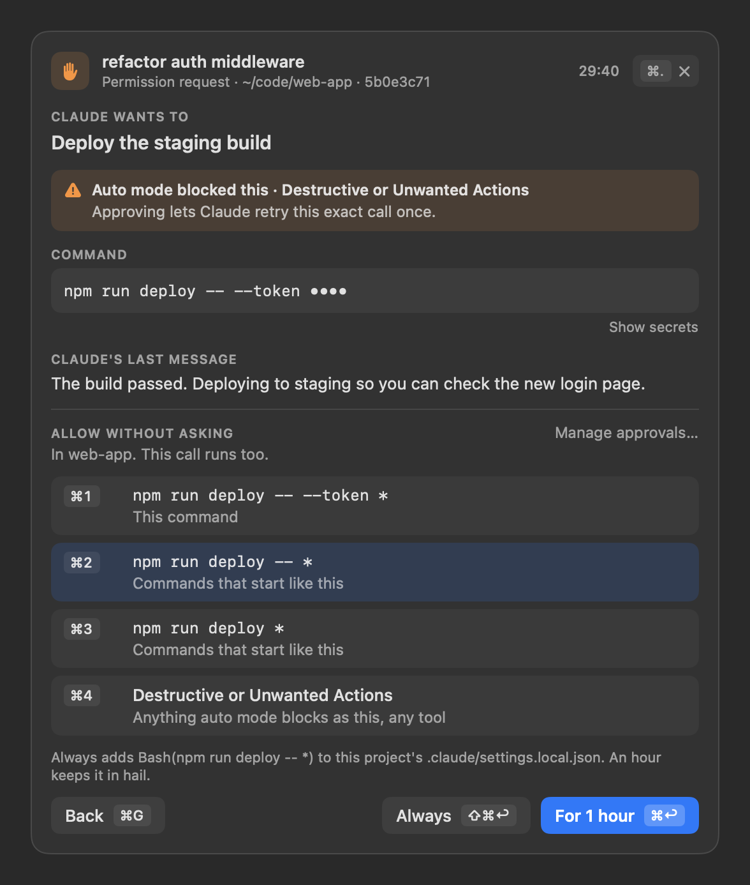
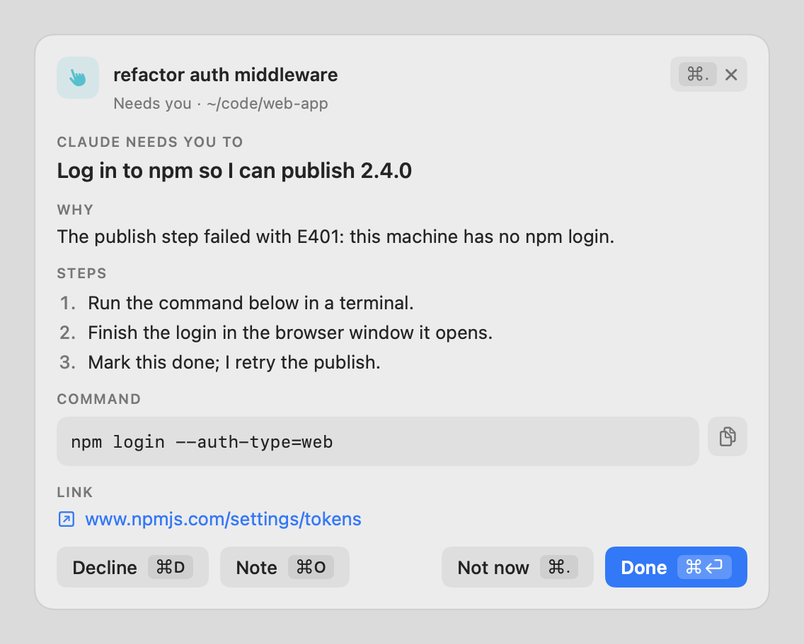
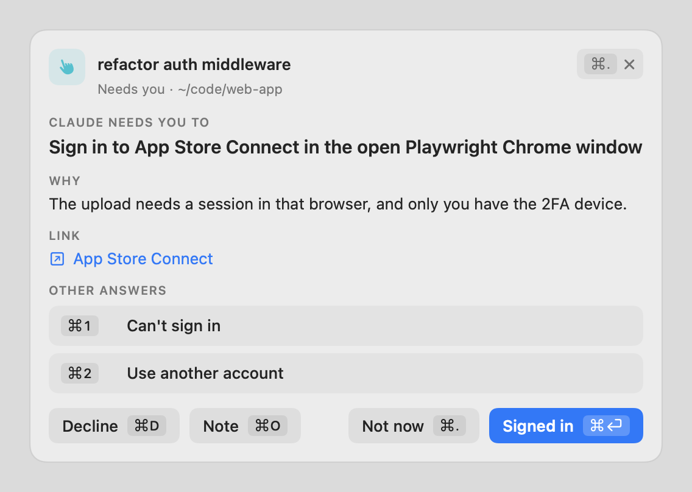
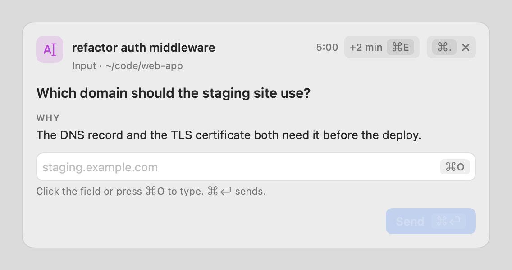
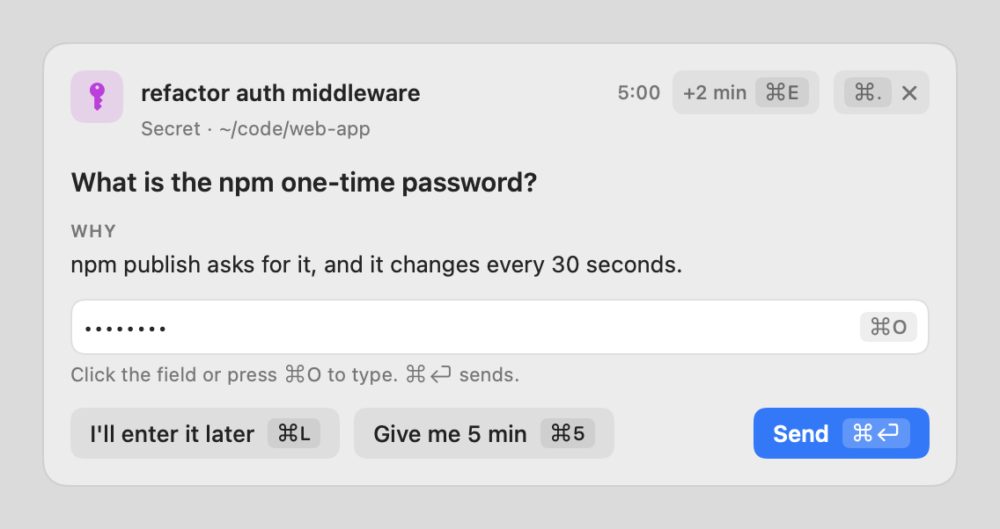
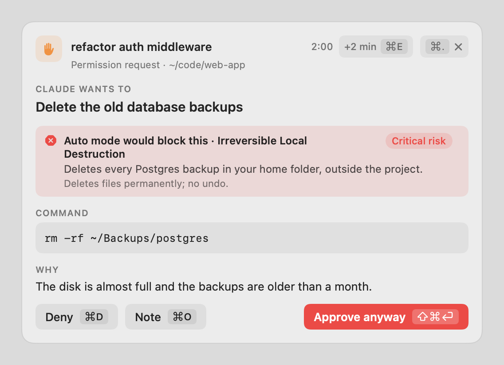

# stew

A macOS panel that lets Claude Code ask you for permission, ask you a question or tell you something, without taking keyboard focus from what you are typing.


- **Auto mode, with you as the fallback.** Claude Code's auto mode decides as usual. When it blocks a call, stew asks you. Approve, and Claude retries that exact call. You can also allow it for an hour, or for good, without being asked again.
- **Permission, questions, notifications.** Claude can call `stew` itself: a permission request with the exact command and the reason, a question in the same format as Claude Code's AskUserQuestion tool, or a notification.
- **Needs you.** When Claude is stuck on something only you can do (log in, buy, approve in a web page, plug something in), stew shows the steps, the commands to copy and the links to open. It stays open until it is done, with a count in the menu bar.
- **Safe while you type.** Nothing answers on plain keys, Space or Return. Every answer is ⌘ plus a key, and only while a panel is visible.
- **Every session in one place.** Each panel names the session it comes from. Several requests queue as "1 of N". You can always dismiss.
- **Nobody waits forever.** You get 1 minute per request by default. If you don't answer, Claude is told you did not respond in time, so it can go another way. ⌘E gives you more time.
- **In the menu bar.** The stew icon counts what waits for you, opens History and Settings, and pauses stew for an hour while you are away.

## Requirements

- macOS 14 or later
- [Claude Code](https://code.claude.com), for the skill, the auto mode hooks and the risk check
- To build from source: a Swift 6 toolchain (Xcode 16 or later, or the Command Line Tools: `xcode-select --install`)

## Install

```bash
brew install --cask koode/apps/stew
```

This installs `/Applications/Stew.app`, links the `stew` command and its shell completion, starts the daemon as the LaunchAgent `nl.koode.stew` and installs the Claude Code skill if `~/.claude` exists (the cask runs `stew setup`). stew then updates itself; `brew upgrade` leaves it alone unless you pass `--greedy`. To also ask in stew when auto mode blocks a call:

```bash
stew hooks install
```

`brew uninstall --cask stew` stops the daemon and removes the app, but keeps the hooks, the skill and stew's data; run `stew hooks uninstall` first, or add `--zap` to remove all of it.

### No Homebrew?

```bash
curl -fsSL https://releases.stewcli.com/install.sh | bash
```

To also ask in stew when auto mode blocks a call:

```bash
curl -fsSL https://releases.stewcli.com/install.sh | bash -s -- --with-hooks
```

The script downloads the latest release and checks it before it changes anything: the size and SHA-256 from the release manifest, and a code signature from Koode's Developer ID that Apple notarized. It then installs:

- `~/Applications/Stew.app`: the daemon and the command line tool. No admin rights needed.
- `~/.local/bin/stew`: a link to the tool inside the app.
- The LaunchAgent `nl.koode.stew`, which starts the daemon at login.
- The Claude Code skill in `~/.claude/skills/stew`, if `~/.claude` exists.
- Shell completion: `~/.config/fish/completions/stew.fish` when fish is installed, and `_stew` in a zsh folder that needs no `.zshrc` change (a writable `site-functions` folder on your fpath, such as Homebrew's; otherwise `~/.zsh/completions`, and the installer prints the one `fpath` line to add). `stew completions install` redoes it, for example after you install Homebrew.

Other options: `--no-skill`, `--no-completions`, `--bin-dir DIR`, `--app-dir DIR`. An older install with a plain binary at `~/.local/bin/stew` is replaced in place, and Claude Code hooks keep working because they call that path.

Moving to Homebrew later works without uninstalling first: the cask removes the completion files the script wrote, `stew setup` points `~/.local/bin/stew` at the new app (so the hooks keep working) and names the old `~/Applications/Stew.app`, which you can then delete.

`stew setup` is the per-user part of both installs, for a Stew.app that is already in place. Run it again after you move the app, or to repair the LaunchAgent: `stew setup [--with-hooks] [--no-skill] [--no-completions] [--bin-dir DIR]`.

### From source

Clone this repository, then from its folder:

```bash
./install.sh                 # Stew.app, background daemon, Claude Code skill
./install.sh --with-hooks    # also: ask in stew when auto mode blocks a call
```

The script builds Stew.app from source and installs the same layout. Run it again to update.

Check that it works:

```bash
stew notify "stew works" --body "Close this with ⌘. or ⌘↩"
```

### Let Claude Code set it up

Open Claude Code in this folder and paste:

> Set up stew for me by following docs/AGENT_SETUP.md. Ask me before you change any settings.

[docs/AGENT_SETUP.md](docs/AGENT_SETUP.md) gives the agent the checks, the two questions to ask you, the install command and the steps to verify.

## How Claude Code uses it

### When auto mode blocks a call

With `--with-hooks`, Claude Code hooks are added to `~/.claude/settings.json` (a backup is written first): one for calls auto mode blocks, one that lets an approved retry through, one for questions, two for things Claude needs you to do, and one that passes on late answers (see below).

1. Auto mode reviews a call as usual. If it allows the call, stew never sees it.
2. If auto mode blocks it, the `PermissionDenied` hook shows the call in stew: the command, auto mode's category for it, and Claude's last message as the reason.
3. You approve (⌘↩), deny (⌘D, optionally with a note for Claude), or dismiss (⌘.). If the time to answer runs out, Claude is told you did not respond in time; you can still answer it later from History (see Late answers).
4. On approval, stew tells Claude Code that Claude may retry. The `PreToolUse` hook lets that identical call through once. A changed call goes back to auto mode.

**Allow more…** (⌘G) skips the question next time:



| You pick | For 1 hour (⌘↩) | Always (⇧⌘↩) |
|---|---|---|
| This command, or a prefix such as `npm run deploy *` | stew lets matching commands through | Added as `Bash(...)` to the project's `.claude/settings.local.json`, so Claude Code enforces it |
| Auto mode's category, such as "Destructive or Unwanted Actions" | stew approves blocked calls in that category for this project | Same, until you revoke it |

- Approvals apply to one project: the git root of the session's folder.
- stew's own approvals never match chained commands (`&&`, `;`, `|`, redirects, `$(…)`).
- Secrets in a command are shown as `••••` (with a button to reveal them) and become `*` in any saved rule.
- `stew approvals` opens a window that lists every standing approval, with Revoke.

What hooks cannot change:

- A **hard deny** rule (such as Data Exfiltration) is meant to block even when you ask. stew asks for ⇧⌘↩ to approve once and offers no standing approvals.
- **Protected paths** (`.git`, `.claude`, shell profiles) stay blocked even with an allow rule.
- Denials without a verdict ("Classifier unavailable") cannot be retried, so stew does not ask.

### Questions in stew

Claude Code's own question tool (AskUserQuestion) can show in stew too, through a third hook. By default this happens only in **unattended** sessions: background jobs and remote sessions, where nobody is at the terminal to answer. A session you are typing in keeps asking in the terminal. Change it in `stew settings` → Claude Code → Questions, or with `"routeQuestions"` in the config: `"unattended"`, `"always"` or `"never"`.

The answer goes back to Claude as if you had answered in the terminal. If the time to answer runs out, or you close the question, Claude is told so and continues with a safe choice. If stew is not running, the terminal asks as usual.

### Needs you: things only you can do

What Claude sessions wait on most is something only you can do: log in, buy more credits, approve a build in a web page, plug in a phone. stew shows it as a **Needs you** panel with what Claude needs, why, numbered steps, each command in a box with a copy button, and links that open in your browser.



- **Done** (⌘↩) tells Claude it is done, optionally with a note (⌘O). **Decline** (⌘D) tells Claude you will not do it.
- Claude can name the Done button after the state you reach ("Signed in", "Bought it") and offer up to 3 other answers ("Can't sign in", "Use another account") on ⌘1 to ⌘3. Each one ends the item and tells Claude which you picked, with your note.


- **Not now** (⌘.) keeps it open for later. It has no time limit.
- Permission requests and questions always go first. A needs item shows when nothing else is waiting.
- The menu bar icon counts open items. Its menu lists each item (session · title) and opens it in the panel.
- When you come back to the Mac, the notice counts what still needs you ("2 things need you"), and an item you put off with Not now shows once more.
- Open items survive a restart. They end when you press Done or Decline, when Claude runs `stew needs resolve ID` after it sees the thing got done, or (for items from the hook below) when you write to that session.

Claude can make one with `stew needs` (the skill tells it when). With the hooks, Claude Code also makes one by itself: when a turn ends with a line that starts with `needs input:`, the `Stop` hook turns that line into the title, a numbered list after it into the steps, code blocks in the message into commands, and up to 4 web addresses outside the code blocks into links. A session has at most one of these at a time, and none while it has an open item from `stew needs`. The `UserPromptSubmit` hook clears it as soon as you send that session a message, and a later turn that ends without a `needs input:` line clears it too (Moved on in the history). Claude Code also runs `UserPromptSubmit` for scheduled tasks, background agents reporting back and messages from other sessions, so those clear the item as well. By default this happens only in unattended sessions (background and remote). Change it in `stew settings` → Claude Code → "Needs you from Claude Code", or with `"autoNeeds"` in the config: `"unattended"`, `"always"` or `"never"`.

### Typed answers

When Claude needs one value it cannot pick from a list, such as a domain, a name, a verification code or a password, it asks with `stew input`. The panel shows the question, why, and one field.



- The field shows what it holds but does not take the keyboard. Click it or press ⌘O to type; Esc leaves it. The clock pauses while you type, as for a note.
- ⌘↩ sends, also from inside the field. Plain Return never sends: in a one-line field it does nothing, and with `--multiline` it adds a line.
- With `--pattern`, ⌘↩ and Send stay off until the whole answer matches, and a line under the field says what form it needs: the `--format` text ("Expected: 6 digits") when Claude gave one, else the pattern itself. `--format` without `--pattern` is refused.
- ⌘. dismisses it without an answer. A plain input that timed out can be answered later from the History, like a question.

**Secrets.** With `--secret` the field shows dots (always 8 until you focus it, so they never tell the length), and stew never writes the answer anywhere: not to the history (the row says a secret was entered), not to its logs or files. You can also type it in the stew app on a paired iPhone (never in a notification), and the Mac treats it the same way. Two more choices show, also on your iPhone: **Give me 5 min** (⌘5) adds 5 minutes, and **I'll enter it later** (⌘L) lets Claude go on now with `"status":"later"`. You then enter it from the History tab (Answer now; Missed only lists it, and the notice when you come back counts it), and it reaches the session as a late answer. A secret that timed out can be entered late the same way. Once entered, the daemon keeps the secret in memory only; if stew stops or restarts before the session picks it up, the secret is gone and Claude is told to ask again.



### The skill

The skill in `~/.claude/skills/stew` tells Claude Code sessions to use stew when you are probably not watching the terminal: background jobs, long tasks, decisions that block progress. Edit `~/.claude/skills/stew/SKILL.md` to change when sessions use it.

### Calling it directly

```bash
# Permission. Exit 0 approved, 1 denied, 2 dismissed, 3 timeout.
stew permit --action "Delete the build cache" --command "rm -rf .build" --reason "It holds objects from an old toolchain."

# Notification. Returns at once; the panel stays until closed.
stew notify "Tests passed" --body "212 of 212" --level success

# Question, in AskUserQuestion format.
stew ask --json '{"questions":[{"question":"Which database?","header":"DB","multiSelect":false,
  "options":[{"label":"Postgres","description":"Relational"},{"label":"SQLite","description":"Embedded"}]}]}'

# One typed answer. Exit 0 answered, 2 dismissed, 3 timeout, 5 later (secrets only).
stew input "Which domain should the staging site use?" --why "The DNS record needs it." \
  --placeholder staging.example.com --pattern '[a-z0-9.-]+\.[a-z]{2,}' --format "a domain name"
#   {"id":"…","status":"answered","text":"staging.example.com"}
#   --default TEXT prefills the field, --multiline lets Return add a line,
#   --secret masks it and keeps the answer out of every file.

# Something only the user can do. Returns at once with {"status":"shown","id":"…"}.
stew needs "Log in to npm so I can publish 2.4.0" --why "The publish failed with E401." \
  --step "Run the command below" --step "Finish the login in the browser" \
  --command "npm login --auth-type=web" --link https://www.npmjs.com/settings/tokens
#   --wait blocks until Done ("done", with the note) or Decline ("dismissed");
#   --timeout SECONDS limits only that wait, and the item stays open.
#   --done LABEL names the Done button ("Signed in"), and --answer LABEL (up to 3)
#   adds other outcomes on ⌘1 to ⌘3. The answer then names the picked label:
#   {"answer":"Signed in","id":"…","status":"done"} or
#   {"answer":"Can't sign in","id":"…","status":"answered"}.
stew needs list [--json]       # the open items
stew needs resolve ID          # clear one once you can see it is done
```

Answers print as one JSON line. `stew --help` lists every command and flag.

### Time to answer

Permission requests, questions and inputs get 1 minute by default (`responseTimeout`). The clock starts when the request reaches the front of the panel, and it pauses while you type a note or pick what to allow. ⌘E adds 2 more minutes (`extendBy`) as often as you like. When the time runs out, the answer is `"status":"timeout"` with a note telling Claude you may be away, that it should continue another way or ask again later, and that a late answer may still follow (see Late answers). `--timeout SECONDS` overrides the limit for one call, and `--timeout 0` turns it off.


For a direct `stew permit`, stew runs its own risk check: `claude -p` judges the command against the rules from `claude auto-mode config`, with your recent messages in the session as context. The verdict shows above the command after approximately 5 seconds. Claude Code's real auto mode prompt is not public, so this check approximates it with the same rules.

#### Severity



The same check also rates how bad the action is if it runs, and says in one line whether it can be undone. Severity is about what the action does, not how sensitive the data it touches is: you approve each action, so reading a secret on this Mac (a keychain lookup, an `.env` file, `op read`) is low or medium. It becomes high or critical when the action also sends the secret out, or uses it to do something that cannot be undone.

| Level | Examples | What changes |
|---|---|---|
| Low risk | Edit files in the repo, `git commit`, `rm -rf` of a build folder | Nothing |
| Medium risk | `git push`, `git reset --hard` (the reflog keeps the commits), installing a package | Nothing |
| High risk | `rm -rf` outside the project, a force-push to a shared branch, `DROP TABLE`, deleting cloud resources | The warning look, and 1 more minute to answer |
| Critical risk | Sending money or emails to customers, deleting production data or backups, publishing a release | The red look, Approve needs ⇧⌘↩ like a hard deny, and 1 more minute to answer |

The panel shows the level as a chip in the risk banner, with the reversibility line under the summary, such as "Can be undone with git reflog." or "Deletes files permanently; no undo." History shows the level in its own column. On the iPhone, high and critical need an extra confirmation before Approve (see [docs/PHONE.md](docs/PHONE.md)). When the risk check is off or fails, there is no severity and nothing changes. Each rule is a setting under Settings ▸ Claude Code ▸ Risk check.

### History: what you missed

Every request is kept for 30 days (`historyDays`) once it ends: when, the session, the request, the command with secrets masked, how it ended and what Claude was told. A request that ran out of time is **missed**; one you closed yourself is not. Missed only (and `stew history --missed`) also lists secrets you chose to enter later, labeled Enter later. A needs item is recorded when it ends: Done, Answered (one of its other answers), Dismissed (declined), Resolved by Claude, Answered in session, or Moved on. For an item with answers of its own, the detail shows the one you picked. Not now is not an ending, so it is not recorded.

When you come back to the Mac after at least 2 minutes away and requests timed out meanwhile, stew shows one notice, "3 requests timed out while you were away", with **Open history** (⌘↩). The same notice counts secrets you chose to enter later ("1 secret to enter") and open needs items ("2 things need you"), and shows on its own when only those are open.

```bash
stew history                    # open the History tab
stew history --missed           # the same, showing only missed requests
stew history --missed --json    # print them as a JSON array, for scripts
```

Until you open History, the menu bar icon counts missed requests too, and its History… entry shows how many.

For a missed call that auto mode blocked, the History tab offers **Allow next time…**: the same choices as Allow more… (this command, a prefix or the category, for 1 hour or always) for that project.

The history is in `~/Library/Application Support/stew/history.jsonl` (mode 0600).

### Late answers

A permission request, question or input that ran out of time can still be answered for 24 hours, and so can a secret you chose to enter later (Enter later in the history). Select it in the History tab and click **Answer now**: it shows in the panel again, without a time limit, and you answer it as usual (approve or deny with a note, pick the options of the question, or type the answer). The row then shows the late outcome, such as "Approved late", what Claude is told, and whether Claude has received it. A paired iPhone can answer such a request late too, for as long as the Mac runs: the answer goes the same way, and the phone shows "Sent as a late answer" (see [docs/PHONE.md](docs/PHONE.md)).

The answer goes to the Claude Code session that asked, through the hooks, at its next step:

| The session is | The answer arrives with |
|---|---|
| Working | The next tool call (`PreToolUse`), as context next to the tool result |
| About to finish | The end of the turn (`Stop`): Claude continues with the answer |
| Idle | Your next message (`UserPromptSubmit`), as context next to it |

- Each answer arrives once, and only in the session that asked. A subagent gets only its own answers; the main agent gets every answer of its session.
- A late approval of a call that auto mode blocked also lets the identical retry through once. Claude is told to retry it if it still needs it.
- Commands in what Claude reads have their secrets masked, as in the history.
- An answer that no hook picks up within 24 hours is dropped. Requests without a Claude Code session (a `stew permit` from your own shell) cannot be answered late.
- Delivery needs the hooks from this version: `stew hooks status` says "partly installed" for an older install, and `stew hooks install` updates it. The `Stop` delivery is a hook that runs in the foreground (only those can keep Claude going); it only reads `late-answers.json`, so it does not slow down the end of a turn.

Waiting requests and late answers are in `~/Library/Application Support/stew/late-answers.json` (mode 0600). A late secret is not: the file holds a placeholder, and the hook fetches the secret from the daemon's memory once, when it delivers the answer.

## On your iPhone

When a request stays open while you are away from your Mac, stew can send it to your iPhone as a notification you can answer: Approve (Face ID first on a locked phone), Deny, More time, a question's options, a typed reply to an input, or Done and the other answers on a needs item. A secret input is typed on the Mac or in the stew app's masked field, never in a notification; the notification offers Enter in app, Give me 5 min and I'll enter it later. The answer goes back to the Mac, end-to-end encrypted through a relay that cannot read it. It needs the stew iPhone app, which is distributed through TestFlight while stew is in beta. Pair a phone in `stew settings` → iPhone. [docs/PHONE.md](docs/PHONE.md) explains when requests are sent, the security model and the wire protocol.

## Keys

Every key is ⌘ plus one key, and works only while a panel is visible. Presses in the first 0.5 seconds after a panel appears are ignored, so a shortcut meant for another app cannot answer it.

| Keys | Action |
|---|---|
| ⌘↩ | Approve, OK on a notification, or Done on a needs item |
| ⌘D | Deny, or Decline a needs item |
| ⌘O | Open the note, "Other" or input field (the only thing that takes keyboard focus) |
| ⌘G | Allow more… on a call auto mode blocked |
| ⌘E | More time (+2 minutes) |
| ⌘1 to ⌘4 | Pick an option, or one of a needs item's other answers |
| ⌘↩ | Confirm a multi-select question, or send typed text. With a question still unanswered, the panel goes to it and says so |
| ⌘5 | Give me 5 min, on a secret input |
| ⌘L | I'll enter it later, on a secret input |
| ⌘[ / ⌘] | Previous or next question |
| ⌘. | Dismiss without answering, or Not now on a needs item |
| ⇧⌘. | Dismiss everything waiting (needs items get Not now) |
| ⇧⌘↩ | Approve past a hard deny, or Always in Allow more… |

The keys avoid ones you press while typing: deny is ⌘D (the macOS "Don't Save" key), not ⌘⌫. Dismiss is ⌘. (the macOS cancel key), not ⌘W. While a panel is visible these keys go to stew, so your terminal's ⌘D or ⌘1 waits until it closes.

Keys follow your keyboard layout, so "D" is the key that types D, also on Dvorak, Colemak or a remapped keyboard.

## Menu bar and pause

The stew icon in the menu bar is the app icon. A count beside it says what waits for you: open needs items, and missed requests you have not seen in History yet. A blue dot means an update is waiting, and the icon turns grey while stew is paused. Its menu lists the open needs items, then History…, Settings…, Pause stew for 1 hour (or Resume stew), an update entry when there is one, and Hide menu bar icon.

**Pause** when you step away: permission requests, questions and inputs then time out at once, and Claude is told you paused stew and are away, so it can go another way. They are recorded as missed, so you can still answer them late from History. Notifications still show, and needs items wait in the menu bar until the pause ends. A pause ends by itself; Resume ends it early and shows what timed out meanwhile. Settings → General shows the pause too.

```bash
stew pause         # for 1 hour
stew pause 20      # for 20 minutes (at most 1440)
stew resume        # end it now
```

Hide the icon with Hide menu bar icon, Settings → General → "Show in menu bar", or `"menuBar": false`. It still shows while a needs item is open, and `stew settings` (or opening Stew.app) brings Settings back.

## Updates

stew updates itself. The daemon checks for a new version one minute after it starts and then once a day, and installs it when no request is open in the panel, then restarts. The first start of the new version shows "stew updated to 0.2.0", with a link to the release notes. Turn installing off in `stew settings` → General → "Install updates automatically", or with `"autoUpdate": false`: stew still checks, and shows one notice per new version with **Install now** (⌘↩) and **Later** (⌘.). The menu bar offers the install too.

```bash
stew version           # the version and build
stew update --check    # is there a newer version?
stew update            # install it now
```

A build from source (`./install.sh`) is not signed with Koode's Developer ID, so it never installs updates: `stew update --check` still reports a newer version, and Settings says to rebuild instead.

stew updates the app it runs from, wherever it is: `/Applications/Stew.app` from Homebrew, `~/Applications/Stew.app` from the script. If your user cannot write to that folder (a standard account and `/Applications`), stew reports the new version and tells you to run `brew upgrade --cask stew` instead.

An update is installed only when the download matches the size and SHA-256 in the release manifest, carries an Ed25519 signature from the stew release key, and the app inside is signed with Koode's Developer ID. Each step is logged to `~/Library/Logs/stew.log`.

| `stew update` exit code | Meaning |
|---|---|
| 0 | Up to date, or the update was installed |
| 10 | An update is available (`--check` only) |
| 11 | A newer version exists but needs a newer macOS |
| 12 | Downloaded and verified; installs as soon as no request is open |
| 20 | The check failed: network, server or an invalid manifest |
| 21 | The download was rejected: size, SHA-256, signature or code signature |
| 22 | Moving the new app into place failed; the old version stays |

## Configuration

Run `stew settings` for a settings window, or edit `~/.config/stew/config.json` directly. The window writes the same file. Every field is optional, and changes apply to the next request without a restart. `stew keys` shows the keys in effect and reports conflicts.


The window has six panes, picked from its toolbar:

- **General:** pause, the menu bar icon, time to answer, more time, arming delay, position, look (solid or glass), sound, confetti, updates.
- **Keys:** click a key and press the new combination.
- **Claude Code:** install or remove the hooks, choose where questions and needs items from Claude Code appear, and set up the risk check.
- **iPhone:** pair and unpair iPhones, and choose when requests go to them (see [docs/PHONE.md](docs/PHONE.md)).
- **Approvals:** the same list as `stew approvals`.
- **History:** finished requests, with a Missed only switch (see History).

```json
{
  "chord": "cmd",
  "keys": { "approve": "return", "deny": "d", "dismiss": ".", "dismissAll": "cmd+shift+.",
            "other": "o", "submit": "return", "next": "]", "previous": "[", "grant": "g", "extend": "e",
            "enterSoon": "5", "enterLater": "l" },
  "optionKeys": ["1", "2", "3", "4"],
  "hardDenyExtra": "shift",
  "armDelay": 0.5,
  "responseTimeout": 60,
  "extendBy": 120,
  "routeQuestions": "unattended",
  "autoNeeds": "unattended",
  "sound": "Glass",
  "position": "top-right",
  "panelLook": "solid",
  "confetti": false,
  "autoUpdate": true,
  "historyDays": 30,
  "menuBar": true,
  "classifier": { "enabled": true, "model": "haiku", "timeoutSeconds": 60, "recentUserMessages": 6,
                  "criticalNeedsStrongApprove": true, "highExtraTime": 60, "phoneConfirmation": "highAndCritical" }
}
```

- A bare key (`"d"`) joins `chord`. A full spec (`"ctrl+option+y"`) stands alone.
- Keys without Control, Option or Command are refused.
- Approve and submit may share a key, because they never show on the same panel. Other clashes are refused.
- `routeQuestions` is `unattended`, `always` or `never`: where Claude Code's own questions appear.
- `autoNeeds` is `unattended`, `always` or `never`: for which sessions a `needs input:` line at the end of a turn becomes a needs item.
- `responseTimeout` and `extendBy` are in seconds. `responseTimeout: 0` turns the time limit off.
- `position` is `top-right`, `top-center` or `top-left`.
- `panelLook` is `solid` or `glass`. Glass puts macOS's Liquid Glass behind the panel, tinted so text stays readable over busy windows. It needs macOS 26 or later; older macOS keeps the solid panel.
- `sound` is a name from `/System/Library/Sounds` (such as `"Glass"`), or `""` for none.
- `confetti` shows a short burst of confetti where the panel was when you approve a request. It is off by default, and never plays when "Reduce motion" is on in macOS.
- `autoUpdate` installs new versions by itself (see Updates).
- `historyDays` is how many days of request history to keep.
- `menuBar` shows the stew icon in the menu bar. Off, it shows only while a needs item is open.
- `phone.viewingCap` is the longest a request's clock stays paused while it is open in the stew app on a paired iPhone, in seconds (900 by default).
- `classifier` controls the risk check on direct `stew permit` calls. `criticalNeedsStrongApprove` asks for ⇧⌘↩ on a critical action. `highExtraTime` is the seconds added to the time to answer for high and critical actions (0 adds none). `phoneConfirmation` is `highAndCritical`, `critical` or `off`: which levels need the extra confirmation before the iPhone approves.

## Security model

- **stew never runs commands.** Claude runs them through its own tools, so Claude Code's permissions, sandbox and transcript still apply.
- **One retry, one call.** An approval lets one identical call through, in the session that asked, within 15 minutes.
- **No API billing.** The risk check runs `claude -p` with no tools, no settings sources (so no hooks) and no saved session. It runs only on a Claude subscription login: API key variables are removed from its environment, and it refuses to run unless `claude auth status` reports a claude.ai login.
- **No self-approval.** The daemon accepts answers only from its own panel. Its test mode, which accepts simulated key presses on its socket, has to be turned on when the daemon starts, so a caller cannot approve its own request.
- **Signed updates only.** An update needs a valid Ed25519 signature from the stew release key and Koode's Developer ID code signature. The release server only serves the files.
- **Local files only.** The socket is `~/Library/Application Support/stew/stew.sock` (mode 0600). Approvals are in `grants.json` next to it. Open needs items are in `needs.json` (mode 0600), with their commands as given so the copy button copies the real command; the panel and the history show secrets as `••••`. Logs go to `~/Library/Logs/stew.log`.
- **Web links only.** A needs item's links must be `http` or `https`, so a click can only open the browser, never a file or an app.

## Uninstall

With Homebrew:

```bash
brew uninstall --cask --zap stew
```

This removes everything: the hooks, the daemon, the app and its links, the skill, caches, stored approvals, the iPhone pairings in the login keychain, `~/.config/stew` and the log. Without `--zap`, Homebrew stops the daemon and removes the app and its links, and keeps the hooks, the skill and stew's data.

Installed with the script:

```bash
stew uninstall
```

`./uninstall.sh` in a clone does the same. This removes the hooks, the daemon, Stew.app, the `~/.local/bin/stew` link, the skill, the shell completion files the installer wrote, caches, stored approvals and the iPhone pairings in the login keychain. It keeps `~/.config/stew` and any allow rules stew added to projects' `.claude/settings.local.json`. Run `stew approvals` first to see and revoke those.

## Develop

```bash
swift test                     # unit tests
Tests/e2e/run.sh               # end-to-end tests against a headless daemon on a private socket
RISK_CHECK=1 Tests/e2e/run.sh  # also runs one real risk check (uses your Claude plan)
Tests/install/run.sh           # the installers, stew setup, stew uninstall and the cask, against a temporary home folder
swift run stew snapshot --out snapshots   # renders sample panels to PNG, light and dark
```

The end-to-end tests use their own socket, grant store, policy file, settings files and a temporary Stew.app, and serve test releases from a local server, so they never touch your installed stew or your Claude Code settings. The installer tests log launchctl calls instead of running them.

[docs/RELEASING.md](docs/RELEASING.md) describes how a release is built, signed and published.

## License

Elastic License 2.0 (ELv2). See [LICENSE](LICENSE). You may use, change and share stew, but not provide it to others as a hosted or managed service, and not get around its license checks.
