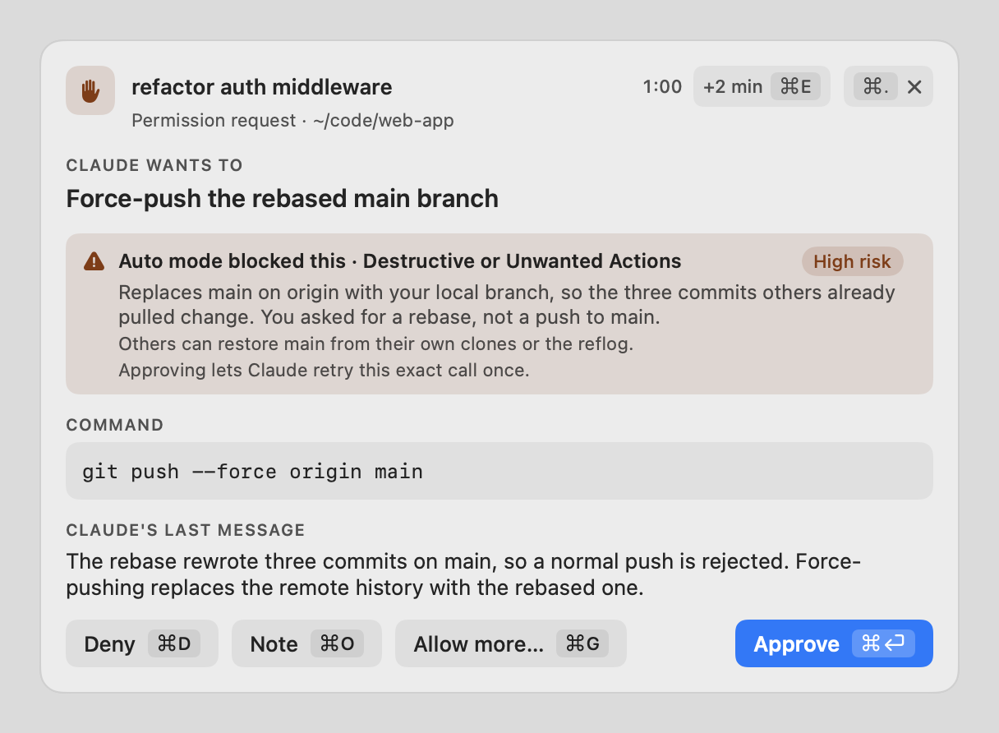
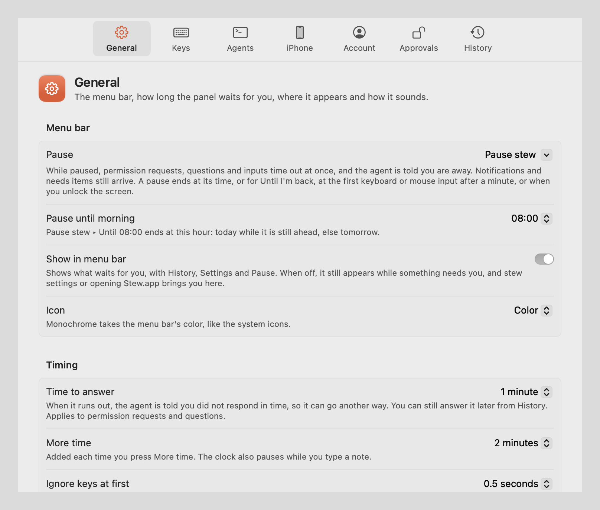

# stew

A macOS panel that lets Claude Code ask you for permission, ask you a question or tell you something, without taking keyboard focus from what you are typing.



- **Auto mode, with you as the fallback.** Claude Code's auto mode decides as usual. When it blocks a call, stew asks you. Approve, and Claude retries that exact call. You can also allow it for an hour, or for good, without being asked again.
- **Permission, questions, notifications.** Claude can call `stew` itself: a permission request with the exact command and the reason, a question in the same format as Claude Code's AskUserQuestion tool, or a notification.
- **Safe while you type.** Nothing answers on plain keys, Space or Return. Every answer is ⌘ plus a key, and only while a panel is visible.
- **Every session in one place.** Each panel names the session it comes from. Several requests queue as "1 of N". You can always dismiss.
- **Nobody waits forever.** You get 1 minute per request by default. If you don't answer, Claude is told you did not respond in time, so it can go another way. ⌘E gives you more time.

## Requirements

- macOS 14 or later
- [Claude Code](https://code.claude.com), for the skill, the auto mode hooks and the risk check
- To build from source: a Swift 6 toolchain (Xcode 16 or later, or the Command Line Tools: `xcode-select --install`)

## Install

```bash
curl -fsSL https://releases.stewcli.com/install.sh | bash
```

To also ask in stew when auto mode blocks a call:

```bash
curl -fsSL https://releases.stewcli.com/install.sh | bash -s -- --with-hooks
```

The script downloads the latest release and checks it before it changes anything: the size and SHA-256 from the release manifest, and a code signature from Koode's Developer ID that Apple notarized. It then installs:

- `~/Applications/Stew.app`: the daemon and the command line tool. No admin rights needed.
- `~/.local/bin/stew`: a link to the tool inside the app.
- The LaunchAgent `nl.koode.stew`, which starts the daemon at login.
- The Claude Code skill in `~/.claude/skills/stew`, if `~/.claude` exists.

Other options: `--no-skill`, `--bin-dir DIR`, `--app-dir DIR`. An older install with a plain binary at `~/.local/bin/stew` is replaced in place, and Claude Code hooks keep working because they call that path.

### From source

Clone this repository, then from its folder:

```bash
./install.sh                 # Stew.app, background daemon, Claude Code skill
./install.sh --with-hooks    # also: ask in stew when auto mode blocks a call
```

The script builds Stew.app from source and installs the same layout. Run it again to update.

Check that it works:

```bash
stew notify "stew works" --body "Close this with ⌘. or ⌘↩"
```

### Let Claude Code set it up

Open Claude Code in this folder and paste:

> Set up stew for me by following docs/AGENT_SETUP.md. Ask me before you change any settings.

[docs/AGENT_SETUP.md](docs/AGENT_SETUP.md) gives the agent the checks, the two questions to ask you, the install command and the steps to verify.

## How Claude Code uses it

### When auto mode blocks a call

With `--with-hooks`, Claude Code hooks are added to `~/.claude/settings.json` (a backup is written first): one for calls auto mode blocks, one that lets an approved retry through, and one for questions (see below).

1. Auto mode reviews a call as usual. If it allows the call, stew never sees it.
2. If auto mode blocks it, the `PermissionDenied` hook shows the call in stew: the command, auto mode's category for it, and Claude's last message as the reason.
3. You approve (⌘↩), deny (⌘D, optionally with a note for Claude), or dismiss (⌘.). If the time to answer runs out, Claude is told you did not respond in time.
4. On approval, stew tells Claude Code that Claude may retry. The `PreToolUse` hook lets that identical call through once. A changed call goes back to auto mode.

**Allow more…** (⌘G) skips the question next time:


| You pick | For 1 hour (⌘↩) | Always (⇧⌘↩) |
|---|---|---|
| This command, or a prefix such as `npm run deploy *` | stew lets matching commands through | Added as `Bash(...)` to the project's `.claude/settings.local.json`, so Claude Code enforces it |
| Auto mode's category, such as "Destructive or Unwanted Actions" | stew approves blocked calls in that category for this project | Same, until you revoke it |

- Approvals apply to one project: the git root of the session's folder.
- stew's own approvals never match chained commands (`&&`, `;`, `|`, redirects, `$(…)`).
- Secrets in a command are shown as `••••` (with a button to reveal them) and become `*` in any saved rule.
- `stew approvals` opens a window that lists every standing approval, with Revoke.

What hooks cannot change:

- A **hard deny** rule (such as Data Exfiltration) is meant to block even when you ask. stew asks for ⇧⌘↩ to approve once and offers no standing approvals.
- **Protected paths** (`.git`, `.claude`, shell profiles) stay blocked even with an allow rule.
- Denials without a verdict ("Classifier unavailable") cannot be retried, so stew does not ask.

### Questions in stew

Claude Code's own question tool (AskUserQuestion) can show in stew too, through a third hook. By default this happens only in **unattended** sessions: background jobs and remote sessions, where nobody is at the terminal to answer. A session you are typing in keeps asking in the terminal. Change it in `stew settings` → Claude Code → Questions, or with `"routeQuestions"` in the config: `"unattended"`, `"always"` or `"never"`.

The answer goes back to Claude as if you had answered in the terminal. If the time to answer runs out, or you close the question, Claude is told so and continues with a safe choice. If stew is not running, the terminal asks as usual.

### The skill

The skill in `~/.claude/skills/stew` tells Claude Code sessions to use stew when you are probably not watching the terminal: background jobs, long tasks, decisions that block progress. Edit `~/.claude/skills/stew/SKILL.md` to change when sessions use it.

### Calling it directly

```bash
# Permission. Exit 0 approved, 1 denied, 2 dismissed, 3 timeout.
stew permit --action "Delete the build cache" --command "rm -rf .build" --reason "It holds objects from an old toolchain."

# Notification. Returns at once; the panel stays until closed.
stew notify "Tests passed" --body "212 of 212" --level success

# Question, in AskUserQuestion format.
stew ask --json '{"questions":[{"question":"Which database?","header":"DB","multiSelect":false,
  "options":[{"label":"Postgres","description":"Relational"},{"label":"SQLite","description":"Embedded"}]}]}'
```

Answers print as one JSON line. `stew --help` lists every command and flag.

### Time to answer

Permission requests and questions get 1 minute by default (`responseTimeout`). The clock starts when the request reaches the front of the panel, and it pauses while you type a note or pick what to allow. ⌘E adds 2 more minutes (`extendBy`) as often as you like. When the time runs out, the answer is `"status":"timeout"` with a note telling Claude you may be away and that it should continue another way or ask again later. `--timeout SECONDS` overrides the limit for one call, and `--timeout 0` turns it off.


For a direct `stew permit`, stew runs its own risk check: `claude -p` judges the command against the rules from `claude auto-mode config`, with your recent messages in the session as context. The verdict shows above the command after approximately 5 seconds. Claude Code's real auto mode prompt is not public, so this check approximates it with the same rules.

### History: what you missed

Every request is kept for 30 days (`historyDays`) once it ends: when, the session, the request, the command with secrets masked, how it ended and what Claude was told. A request that ran out of time is **missed**; one you closed yourself is not.

When you come back to the Mac after at least 2 minutes away and requests timed out meanwhile, stew shows one notice, "3 requests timed out while you were away", with **Open history** (⌘↩).

```bash
stew history                    # open the History tab
stew history --missed           # the same, showing only missed requests
stew history --missed --json    # print them as a JSON array, for scripts
```

For a missed call that auto mode blocked, the History tab offers **Allow next time…**: the same choices as Allow more… (this command, a prefix or the category, for 1 hour or always) for that project.

The history is in `~/Library/Application Support/stew/history.jsonl` (mode 0600).

## Keys

Every key is ⌘ plus one key, and works only while a panel is visible. Presses in the first 0.5 seconds after a panel appears are ignored, so a shortcut meant for another app cannot answer it.

| Keys | Action |
|---|---|
| ⌘↩ | Approve, or OK on a notification |
| ⌘D | Deny |
| ⌘O | Open the note or "Other" field (the only thing that takes keyboard focus) |
| ⌘G | Allow more… on a call auto mode blocked |
| ⌘E | More time (+2 minutes) |
| ⌘1 to ⌘4 | Pick an option |
| ⌘↩ | Confirm a multi-select question, or send typed text |
| ⌘[ / ⌘] | Previous or next question |
| ⌘. | Dismiss without answering |
| ⇧⌘. | Dismiss everything waiting |
| ⇧⌘↩ | Approve past a hard deny, or Always in Allow more… |

The keys avoid ones you press while typing: deny is ⌘D (the macOS "Don't Save" key), not ⌘⌫. Dismiss is ⌘. (the macOS cancel key), not ⌘W. While a panel is visible these keys go to stew, so your terminal's ⌘D or ⌘1 waits until it closes.

Keys follow your keyboard layout, so "D" is the key that types D, also on Dvorak, Colemak or a remapped keyboard.

## Updates

stew updates itself. The daemon checks for a new version one minute after it starts and then once a day, and installs it when no request is open in the panel, then restarts. Turn this off in `stew settings` → General → "Install updates automatically", or with `"autoUpdate": false`.

```bash
stew version           # the version and build
stew update --check    # is there a newer version?
stew update            # install it now
```

An update is installed only when the download matches the size and SHA-256 in the release manifest, carries an Ed25519 signature from the stew release key, and the app inside is signed with Koode's Developer ID. Each step is logged to `~/Library/Logs/stew.log`.

| `stew update` exit code | Meaning |
|---|---|
| 0 | Up to date, or the update was installed |
| 10 | An update is available (`--check` only) |
| 11 | A newer version exists but needs a newer macOS |
| 12 | Downloaded and verified; installs as soon as no request is open |
| 20 | The check failed: network, server or an invalid manifest |
| 21 | The download was rejected: size, SHA-256, signature or code signature |
| 22 | Moving the new app into place failed; the old version stays |

## Configuration

Run `stew settings` for a settings window, or edit `~/.config/stew/config.json` directly. The window writes the same file. Every field is optional, and changes apply to the next request without a restart. `stew keys` shows the keys in effect and reports conflicts.



The window has five tabs:

- **General:** time to answer, more time, arming delay, position, sound, confetti, updates.
- **Keys:** click a key and press the new combination.
- **Claude Code:** install or remove the auto mode hooks, and set up the risk check.
- **Approvals:** the same list as `stew approvals`.
- **History:** finished requests, with a Missed only switch (see History).

```json
{
  "chord": "cmd",
  "keys": { "approve": "return", "deny": "d", "dismiss": ".", "dismissAll": "cmd+shift+.",
            "other": "o", "submit": "return", "next": "]", "previous": "[", "grant": "g", "extend": "e" },
  "optionKeys": ["1", "2", "3", "4"],
  "hardDenyExtra": "shift",
  "armDelay": 0.5,
  "responseTimeout": 60,
  "extendBy": 120,
  "routeQuestions": "unattended",
  "sound": "Glass",
  "position": "top-right",
  "confetti": false,
  "autoUpdate": true,
  "historyDays": 30,
  "classifier": { "enabled": true, "model": "haiku", "timeoutSeconds": 60, "recentUserMessages": 6 }
}
```

- A bare key (`"d"`) joins `chord`. A full spec (`"ctrl+option+y"`) stands alone.
- Keys without Control, Option or Command are refused.
- Approve and submit may share a key, because they never show on the same panel. Other clashes are refused.
- `routeQuestions` is `unattended`, `always` or `never`: where Claude Code's own questions appear.
- `responseTimeout` and `extendBy` are in seconds. `responseTimeout: 0` turns the time limit off.
- `position` is `top-right`, `top-center` or `top-left`.
- `sound` is a name from `/System/Library/Sounds` (such as `"Glass"`), or `""` for none.
- `confetti` shows a short burst of confetti where the panel was when you approve a request. It is off by default, and never plays when "Reduce motion" is on in macOS.
- `autoUpdate` installs new versions by itself (see Updates).
- `historyDays` is how many days of request history to keep.
- `classifier` controls the risk check on direct `stew permit` calls.

## Security model

- **stew never runs commands.** Claude runs them through its own tools, so Claude Code's permissions, sandbox and transcript still apply.
- **One retry, one call.** An approval lets one identical call through, in the session that asked, within 15 minutes.
- **No API billing.** The risk check runs `claude -p` with no tools, no settings sources (so no hooks) and no saved session. It runs only on a Claude subscription login: API key variables are removed from its environment, and it refuses to run unless `claude auth status` reports a claude.ai login.
- **No self-approval.** The daemon accepts answers only from its own panel. Its test mode, which accepts simulated key presses on its socket, has to be turned on when the daemon starts, so a caller cannot approve its own request.
- **Signed updates only.** An update needs a valid Ed25519 signature from the stew release key and Koode's Developer ID code signature. The release server only serves the files.
- **Local files only.** The socket is `~/Library/Application Support/stew/stew.sock` (mode 0600). Approvals are in `grants.json` next to it. Logs go to `~/Library/Logs/stew.log`.

## Uninstall

```bash
stew uninstall
```

`./uninstall.sh` in a clone does the same. This removes the hooks, the daemon, Stew.app, the `~/.local/bin/stew` link, the skill, caches and stored approvals. It keeps `~/.config/stew` and any allow rules stew added to projects' `.claude/settings.local.json`. Run `stew approvals` first to see and revoke those.

## Develop

```bash
swift test                     # unit tests
Tests/e2e/run.sh               # end-to-end tests against a headless daemon on a private socket
RISK_CHECK=1 Tests/e2e/run.sh  # also runs one real risk check (uses your Claude plan)
Tests/install/run.sh           # the installers and stew uninstall, against a temporary home folder
swift run stew snapshot --out snapshots   # renders sample panels to PNG, light and dark
```

The end-to-end tests use their own socket, grant store, policy file, settings files and a temporary Stew.app, and serve test releases from a local server, so they never touch your installed stew or your Claude Code settings. The installer tests log launchctl calls instead of running them.

[docs/RELEASING.md](docs/RELEASING.md) describes how a release is built, signed and published.

## License

Elastic License 2.0 (ELv2). See [LICENSE](LICENSE). You may use, change and share stew, but not provide it to others as a hosted or managed service, and not get around its license checks.
