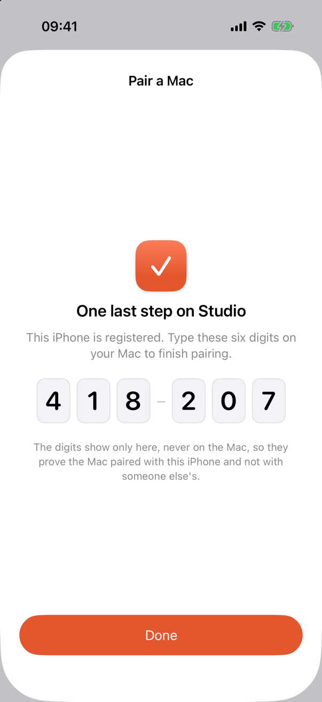
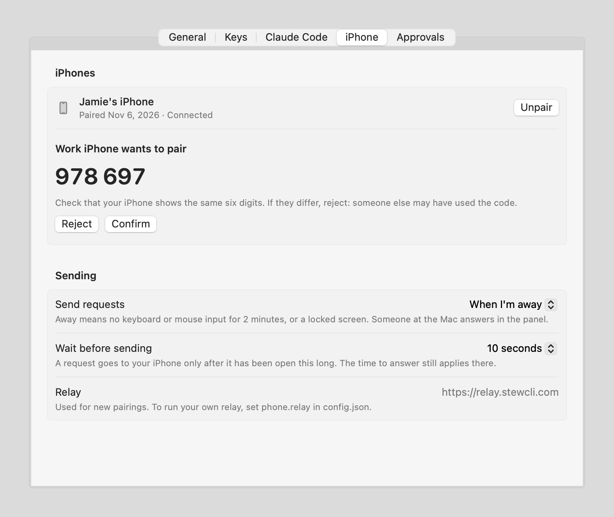
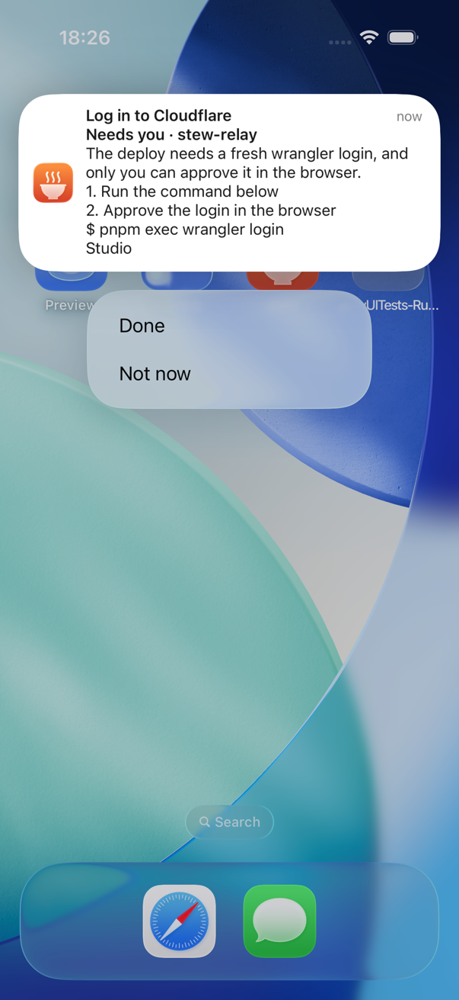
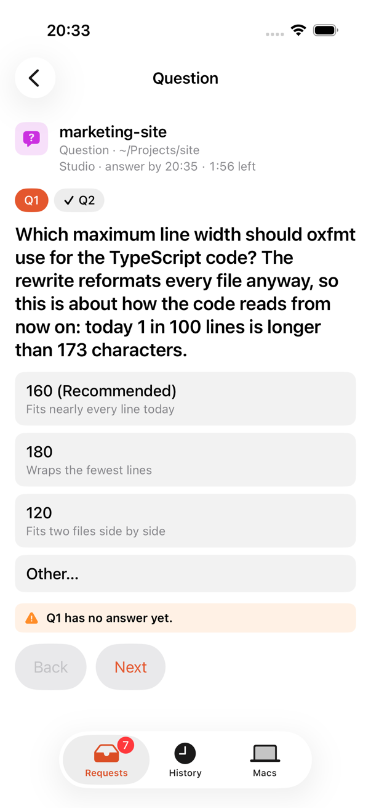
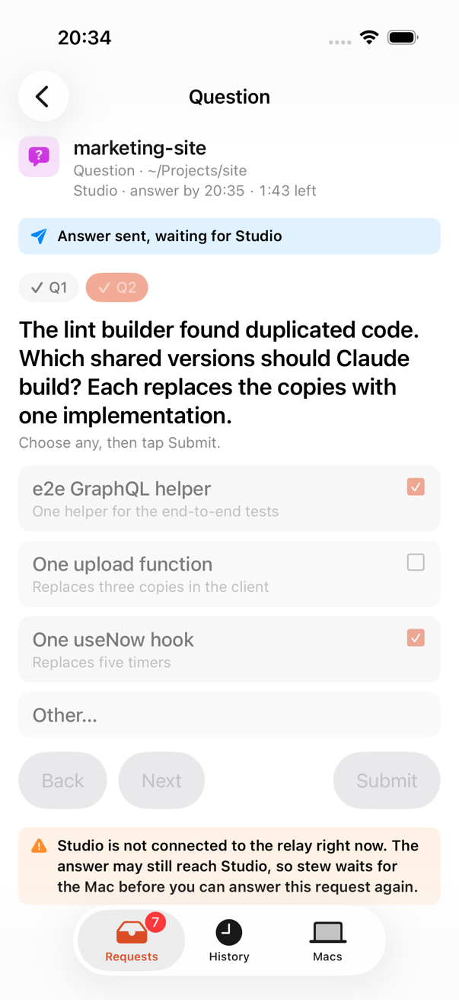
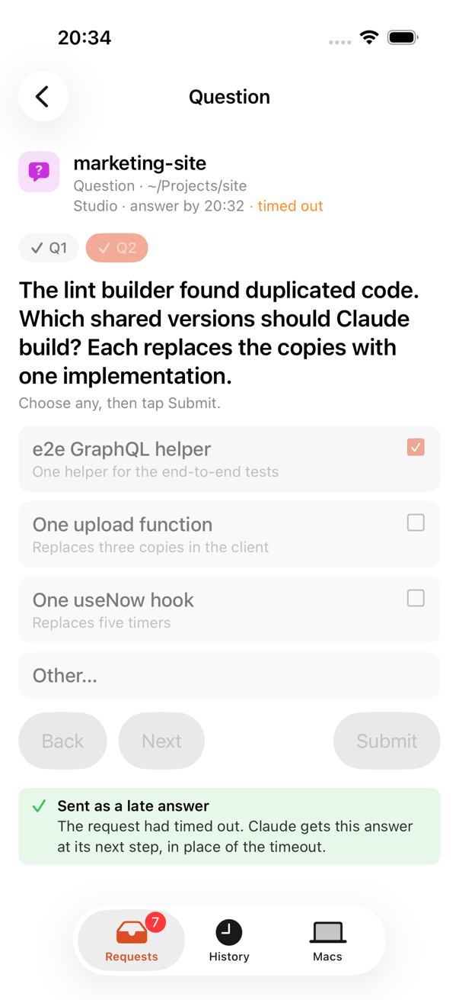
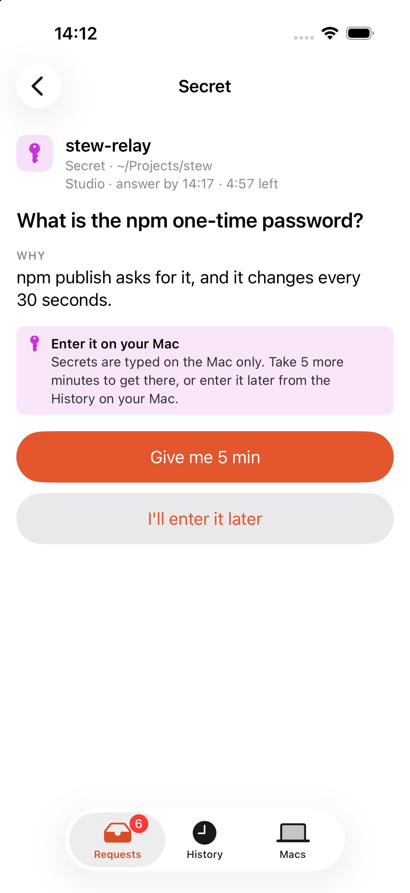

# stew on your iPhone

When a request stays open while you are away from your Mac, stew sends it to your iPhone as a notification you can answer. The answer goes back to the Mac, and Claude gets it as if you had answered in the panel.

## How it behaves

- **When it pushes.** A request goes to the phone once it has been open 10 seconds (`phone.after`) and the Mac is idle (no keyboard or mouse input for 2 minutes, `phone.idleAfter`) or its screen is locked. Settings ▸ iPhone ▸ Send requests offers "When I'm away" (the default), "Always" and "Never" (`phone.push`: `away`, `always`, `never`).
- **The time limit still applies.** The notification shows when the time to answer runs out. More time on the phone adds the same time as ⌘E on the Mac.
- **Late answers.** When the time runs out on a permission request, question or input from a Claude Code session, the phone can still answer it for 24 hours, like Answer now in the Mac's History: an open request screen stays open and says "Time ran out", and History lists the request with Answer now. Approve, Deny, the question's answers or a typed reply then go to the Mac, which passes them to the session as a late answer, exactly as if you answered from its History, and the phone shows "Sent as a late answer". The History row then shows the late outcome, such as "Approved late". More time cannot bring a request back, a secret is typed in the app's masked field, never in a notification, and Approve on a request auto mode never allows stays Mac-only. A request answered elsewhere or dismissed stays refused, and the phone says why. A request without a Claude session id (a `stew` call outside Claude Code) cannot take a late answer, so the phone refuses it as too late. The Mac remembers which phone may answer late only while it runs: after a restart, answer late on the Mac.
- **First answer wins.** When the request is answered anywhere (Mac, phone or another phone), times out or is dismissed, the phone's notification is replaced, without a sound, by one that says how it ended ("Answered on Studio", "Approved on Sam's iPhone", "Timed out", "Dismissed on Studio") and has no actions, so a stale Approve never remains. Opening the app clears those, and also clears the notification of any request that ended while no push could reach the phone, such as one that timed out while the Mac slept. A push for a request that already ended on the phone, such as a late update, never brings it back.
- **Opening a request stops the rush.** While a permission request, question or input is open on screen in the stew app, the Mac pauses its clock, the same as while you type a note on the Mac. The Mac panel shows "On <phone name>" with an iPhone symbol in place of the countdown, and the phone shows "No rush: the clock is paused while you answer." The clock runs again 30 seconds after you leave the request or put the app in the background, and other paired phones get the new deadline. Opening it again pauses it again, but only up to 15 minutes from the first open (Settings ▸ iPhone ▸ Longest pause while open on iPhone, `phone.viewingCap` in seconds); then the request times out, and Claude is told it was open on your iPhone that long. iOS does not tell the app when you expand a notification, so only an open request screen pauses the clock.
- **More time everywhere.** Permission, question and input notifications offer More time when the request has a time limit, and so do the request, question and input screens in the app. It works like ⌘E on the Mac.
- **Hard denies stay on the Mac.** A call auto mode never allows can be approved on the Mac only. The phone shows it and offers Deny and More time, but no Approve.
- **Severity.** The notification and the request screen show the risk check's level ("High risk") and its line on whether the action can be undone. For high and critical requests, the notification has no Approve: it offers Review, which opens the request in the app, plus Deny and More time. Approve in the app then shows a confirmation sheet that restates the action, the command (secrets masked) and the reversibility line, before Face ID or the passcode. For critical, you hold Approve down for about 1.5 seconds, and the sheet says it cannot be undone. Settings ▸ Claude Code ▸ Risk check ▸ Extra confirmation on iPhone sets which levels get the sheet: High and critical (the default), Critical only, or Off. The Mac refuses an approval of such a request that does not say it went through the sheet, so a stale notification action cannot skip it, and an app from before severity gets a refusal that asks to update it.
- **Approve needs an unlocked phone.** On a locked phone the Approve action asks for Face ID or the passcode first. On an unlocked phone, and on the Watch while it is unlocked on your wrist, iOS does not ask again. Approve in the app always asks. Deny and More time never ask.
- **Risk check first.** A request waits while its risk check runs, so the phone sees the verdict and a hard deny never arrives with an Approve.
- **Questions.** A single question offers its options (up to 4) and "Other…" with a text field. Several questions, or a multi-select question, open the app.
- **Inputs** (`stew input`) go out under the same rules as questions. The notification shows the question and why, with a **Reply** text field (its placeholder is the input's `--placeholder`). The app shows the same field. With `--pattern`, the phone refuses a reply that does not match before sending it, saying what is expected in the `--format` words when Claude gave them, and the Mac checks it again and refuses it too, so the request stays open for a reply that fits.
- **Secret inputs** (`--secret`) go out too. You type a secret on the Mac or in the stew app, never in a notification: a notification text field cannot hide what you type. The notification shows the question, why, and "Enter it on your Mac or in the stew app.", with three actions that need no Face ID. **Enter in app** opens the request in the app, which has a masked field checked against the same `--pattern` and `--format` as on the Mac. **Give me 5 min** adds 5 minutes to the clock on the Mac and on the phone. **I'll enter it later** ends Claude's wait at once with `"status":"later"`; you then enter the secret on the Mac from History ▸ Answer now, or in the app from its History, and it reaches the session as a late answer. A secret typed in the app goes to the Mac end-to-end encrypted like any answer, and the phone never writes it anywhere: not to its shared state, its history, its notifications or its logs. The Mac checks it again and handles it exactly like a secret typed in its panel: never in its history, logs or files, and a late one held in the daemon's memory only, until the session's next hook fetches it. The Mac never sends a secret to the phone, and it refuses a secret sent as a plain reply. A Mac from before this feature does not mark its secrets as enterable in the app, so the app then shows "Enter it on your Mac" without a field.
- **Notifications** (`stew notify`) arrive without actions.
- **stew's own notices stay on the Mac.** The notices stew shows by itself, "stew updated to 0.2.0", "stew 0.2.0 is available" and "3 requests timed out while you were away", are about the Mac and never go to the phone.
- **Needs items** (`stew needs`) go out once they have been open 10 seconds, also while you are at the Mac, because they have no deadline and the task often takes you away from the desk. "Never" still sends none. The notification shows the title, why, the steps and the commands with secrets masked, with Done and Not now. When Claude named the Done button (`--done`) or offered other answers (`--answer`), the actions carry those labels: Done with its label, each other answer, then Not now, in a notification category made for that item. Done and the other answers need no Face ID; Done ends the item on the Mac as Done, another answer ends it as Answered, and Claude learns which label was picked. The Mac takes an answer only when the item offers that label, so an answer from a stale or forged notification is refused. Done keeps its old form on the wire, so an iPhone app from before the labels still ends such an item with Done. Not now only clears the notification; the item stays open on the Mac. An item you parked with Not now on the Mac is not sent. The phone's history uses the Mac's labels: Done, Dismissed, Resolved by Claude, Answered in session, Moved on.
- **Apple Watch** shows the same actions, without a watch app.

## Pairing

1. On the Mac: Settings ▸ iPhone ▸ Pair an iPhone. stew shows a QR code. The same code is a `stew://pair?code=…` link that you can copy and paste on the phone instead. The code works for 10 minutes and for one phone; Settings counts down the time it has left. A copied code leaves the clipboard after a minute.
2. On the iPhone: in the stew app, tap Pair a Mac and scan the code, or paste it.
3. The iPhone shows six digits. Type them on the Mac. The Mac never shows them, so they can only come from your phone. If the phone shows none (another device used the code first), reject on the Mac.






A Mac can pair with several phones and a phone with several Macs. Each pairing has its own id, its own pairing secret and its own key. Unpairing on either side removes the pairing on both.

## Configuration

The `phone` object in `~/.config/stew/config.json`. Every field is optional.

```json
{ "phone": { "push": "away", "after": 10, "idleAfter": 120, "relay": "https://relay.stewcli.com" } }
```

- `push`: `away`, `always` or `never`. An unknown value counts as `away`.
- `after`: seconds a request must be open before it is sent. `0` sends it at once (stew checks every second). Settings offers Instantly, 3, 5, 10 and 30 seconds, 1 and 2 minutes.
- `idleAfter`: seconds without keyboard or mouse input before the Mac counts as away.
- `relay`: the relay for new pairings. Each pairing keeps the relay it was made with, so change this before pairing. [relay/README.md](../relay/README.md) explains self-hosting.

## Testing

```bash
swift test              # StewLink: encryption, signatures, replays, expiry, notification text, history
Tests/phone/run.sh      # a local relay in MOCK_APNS mode, a headless daemon and a test phone (RELAY_PORT picks its port)
```

`Tests/phone/run.sh` needs the relay's dependencies (`pnpm install` in `relay/`) and runs everything on this Mac: the relay records pushes instead of sending them to Apple, and `stew-test-phone` decrypts them with the same code as the iOS app and answers.

## iPhone app

The app is in `ios/App`: the app (`nl.koode.stew.ios`), its notification service extension, unit tests and a UI test target that takes screenshots. It uses the `StewLink` package from the repository root for every message, key and sentence, so the phone and the Mac say the same thing.


Needs items show the same parts as the Mac panel: the title, Why, the steps, the commands with secrets masked, and the links. Done (with Claude's label for it) and the other answers tell Claude how to go on and ask for no Face ID, because they run nothing. Not now sends nothing: the notification goes, and the item stays in Requests and on the Mac. Needs items have no time limit, so they never show as missed.



Questions follow the Mac panel's rules: a single-select option answers and moves on, multi select toggles until Confirm, and Other… takes typed text. The last question of a set always shows Submit, so a send that failed can be tried again. Submit or Confirm while a question has no answer goes to the first open question and says so ("Q1 has no answer yet."), as ⌘↩ does on the Mac; it never does nothing. While the answer goes out the button shows "Sending…". When it fails or the Mac refuses it, the reason shows on the screen under the buttons, which scroll into view, and the answers stay as they were for another try. The Mac also writes every refusal of a phone answer to its log.







Inputs show the question, Why and an Answer field; Send stays off until the answer fits the pattern. A secret shows a masked Secret field with Send, and Give me 5 min and I'll enter it later under it. From an older Mac it shows "Enter it on your Mac" with only those two.



An iPhone app from before inputs cannot read an input request: its notification keeps the relay's generic text ("A request is waiting on your Mac."), and its Requests list skips it. Answer it on the Mac, or update the app.

### Building

The Xcode project is generated from `ios/App/project.yml` and is not committed.

```bash
brew install xcodegen
cd ios/App && xcodegen generate
xcodebuild build -project Stew.xcodeproj -scheme Stew -destination 'platform=iOS Simulator,name=iPhone 17 Pro'
```

`ios/tools/testflight.sh` archives a release build and uploads it to TestFlight with the App Store Connect API key. Debug builds register with the relay as `sandbox`, release builds as `production`.

### Testing

```bash
cd ios/App
xcodebuild test -project Stew.xcodeproj -scheme Stew -destination 'platform=iOS Simulator,name=iPhone 17 Pro' -only-testing:StewTests
```

The unit tests seal real envelopes with a fake Mac's keys and answer through a stubbed relay. `StewUITests` is a screenshot harness, not a gate.

On the simulator, debug builds take three launch arguments. None of them exist in release builds.

- `-StewSeed <base64>` installs the phone state that `stew-test-phone sample-push --out DIR` writes to `DIR/seed.txt`, without a relay.
- `-StewDeliver <base64>` runs a push payload (`base64 -i DIR/push-permission.json`) through the notification extension's code in the app and shows the result 15 seconds later. `xcrun simctl push` delivers payloads, but the simulator does not start notification service extensions for them, so this is how to see a decrypted notification there.
- `-StewDemo [requests|request|question|questions|questions-offline|late|needs|input|secret|history|macs]` shows sample requests and history on that screen, for screenshots. `questions` is a set of two questions, `questions-offline` the same set with the Mac offline, and `late` that set after its time ran out. A demo never contacts a relay: a stand-in answers for the Mac.

### Screenshots

`StewUITests/ScreenShots/testAnswerFeedback` taps through the question demos and captures Submit with a question left open, sending, a failed send, and a late answer; run it once more with the simulator dark and `TEST_RUNNER_STEW_APPEARANCE=dark` for the dark versions. `StewUITests/ScreenShots/testNotification` launches the app with `TEST_RUNNER_STEW_SEED` and `TEST_RUNNER_STEW_PUSH`, goes to the Home Screen, and captures the banner and the expanded notification. Export them with `xcrun xcresulttool export attachments`. The app screens come from `-StewDemo` and `xcrun simctl io <device> screenshot`. A headless simulator applies `xcrun simctl ui <device> appearance dark` only after a reboot.

## Security

- **End to end.** Every message is encrypted with ChaCha20-Poly1305 and signed with the sender's Ed25519 key. The key comes from HKDF-SHA256 over the X25519 shared secret of the two devices, salted with the 32 byte pairing secret from the QR code.
- **What the relay sees.** The pairing id, the phone's push token, the public keys, and for each message: its kind (request, update, resolved, answer, result, hello, unpair), the sender side (mac or phone), the request id, the message id and the expiry. It never sees the session, the command, the question or the answer. Plaintext is padded to 256 byte blocks, so message sizes do not tell approve from deny. Message order still shows one thing: More time is followed by an update, a final answer by a resolved message.
- **What the relay cannot do.** It cannot read or forge a request or an answer: it does not have the pairing secret, so it cannot derive the key, and it does not have the private signing keys. A relay that swapped in its own keys during pairing would fail on the encryption, and the six digits would not match. A relay that holds an answer back cannot apply it later: the Mac refuses answers more than 30 seconds old.
- **Replays.** Each message has a unique id and an expiry. The receiver refuses expired messages and message ids it has already seen, and the Mac takes only the first answer to a request. The Mac keeps seen ids in memory only; request ids are new each run, so an answer from before a restart finds nothing to answer.
- **Keys.** On the Mac, the private keys and pairing records are in the login keychain (service `nl.koode.stew.link`). On the iPhone they are in the app group keychain shared by the app and its notification extension.
- **No self-approval.** A phone counts only after the user types its digits on the Mac. A process on the Mac that took a copied code and registered first gets no further: the real phone shows no digits, so there is nothing to type. Pairing through the socket exists only in the headless test daemon.

## Wire protocol

This section is the contract between the Mac, the relay and the phone. Swift types are in `Sources/StewLink`.

### Encodings

- JSON bodies carry binary fields (keys, ciphertext, signatures) as standard base64 with padding.
- Query strings carry signatures as base64url without padding.
- Ids (pairing, request, message) are 1 to 64 characters of `A-Z a-z 0-9 - _`.
- Times on the wire are Unix seconds.

### Envelope

```json
{ "v": 1, "pairingId": "…", "kind": "request", "sender": "mac", "requestId": "…",
  "messageId": "…", "replyTo": "", "expiresAt": 1800000000,
  "ciphertext": "<base64>", "signature": "<base64>" }
```

- `kind`: `hello`, `request`, `update`, `resolved`, `answer`, `result`, `unpair`.
- `sender`: `mac` or `phone`.
- `requestId`: the request the message is about; `pairing` for hello and unpair.
- `replyTo`: for a result, the message id of the answer it replies to; empty otherwise.
- `ciphertext`: ChaCha20-Poly1305 combined box (12 byte nonce, ciphertext, 16 byte tag). The associated data is the header below.
- Header: the lines `stew-link/1`, pairingId, kind, sender, requestId, messageId, replyTo, expiresAt, joined with `\n`.
- `signature`: Ed25519 over the header, `\n`, and the ciphertext as the same base64 text the JSON carries.

### Relay endpoints

All paths start with `/v1/pairings/{pairingId}`. The relay keeps one Durable Object per pairing id. Signed GET requests carry `?ts=<unix seconds>&sig=<base64url>`; the relay refuses a timestamp more than 300 seconds from its clock.

| Method and path | Caller | Body or auth | Result |
|---|---|---|---|
| `POST /claim` | Mac | `{macSigningKey, registrationTokenHash, timestamp, signature}`, signed text `stew-link/1 claim\n{id}\n{hash}\n{ts}` | 201 claimed, 200 already this Mac's, 409 another key holds it |
| `POST /device` | phone, first time | `{registrationToken, deviceToken, environment, phoneKeys, hello}` | 201; 403 wrong token; 409 already used |
| `POST /device` | phone, later | `{deviceToken, environment, timestamp, signature}`, signed text `stew-link/1 device\n{id}\n{deviceToken}\n{environment}\n{ts}` | 200 |
| `GET /socket` | Mac | WebSocket; signed text `stew-link/1 socket\n{id}\n{ts}` | frames to the Mac |
| `POST /messages` | either | an envelope | see below |
| `GET /pending` | phone | signed text `stew-link/1 pending\n{id}\n{ts}` | `{requests: [envelope], resolved: [envelope]}` |
| `GET /v1/test/pushes/{pairingId}` | tests | only with `MOCK_APNS=1` | `{pushes: [{at, host, path, headers, payload}]}` |

- `registrationTokenHash` is the lowercase hex SHA-256 of the registration token's UTF-8 text. The token is base64url of HKDF-SHA256 over the pairing secret with info `stew-link/1 registration`. The relay deletes the hash once a phone has registered, so a code pairs one phone.
- `environment` is `production` or `sandbox` and picks the APNs host.
- The hello envelope must be signed by `phoneKeys.signing`. The relay passes it on to the Mac as `{"type":"hello","envelope":…,"phoneKeys":…}`.
- The relay stores the hello frame and a phone's `unpair` frame until the Mac acknowledges them with `{"type":"ack","messageId":"<the envelope's messageId>"}` on its socket, or until the envelope expires. It sends every unacknowledged frame, oldest first, each time the Mac connects, so the Mac can receive one more than once. Acks count only on the Mac's socket; an ack for an unknown id is ignored. Answers need no ack, because their result comes back in the same exchange.

`POST /messages` checks the envelope's fields, that its pairing id matches the path, its expiry (not past, at most 7 days ahead), its signature against the stored key of the sender, that its message id is new, and the pairing's rate limit (429 with Retry-After). Then:

| Sender and kind | What the relay does |
|---|---|
| mac `request` | Stores it as pending, sends an alert push. 202, or 409 `no_device` |
| mac `update` | Replaces the pending copy, sends a background push. 202 |
| mac `resolved` | Drops the pending copy, keeps the envelope for an hour. Sends a closed alert push when the request was pending (so its alert went out), else a background push. 202 |
| mac `result` | Hands it to the phone's waiting answer with that `replyTo`. 202 |
| mac `unpair` | Sends a background push, then deletes the pairing. 202 |
| phone `answer` | Sends `{"type":"envelope","envelope":…}` on the Mac's socket and waits up to 10 seconds for the result. 200 `{result: envelope}`, 503 `mac_offline`, 504 `mac_timeout` |
| phone `unpair` | Passes it on to the Mac (queued if it is offline), then deletes the phone's data. 202 |

### Pushes

The relay signs an ES256 JWT with the APNs key (`APNS_KEY`, `APNS_KEY_ID`, `APNS_TEAM_ID`) and posts to `https://api.push.apple.com/3/device/{token}` (`api.sandbox.push.apple.com` for sandbox tokens) with topic `APNS_TOPIC`.

Alert push, for `request`:

```json
{ "aps": { "alert": { "title": "stew", "body": "A request is waiting on your Mac." },
           "mutable-content": 1, "sound": "default", "thread-id": "<pairingId>" },
  "stew": { "pairingId": "…", "requestId": "…", "kind": "request", "envelope": { … } } }
```

Headers: `apns-push-type: alert`, `apns-priority: 10`, `apns-expiration: <expiresAt>`, `apns-collapse-id: <requestId>`. When the payload would exceed 4 KB, `envelope` is left out and the notification extension fetches it from `GET /pending`.

Closed alert push, for `resolved` of a request that was pending:

```json
{ "aps": { "alert": { "title": "stew", "body": "This request is closed." },
           "mutable-content": 1, "interruption-level": "passive", "category": "stew.closed",
           "thread-id": "<pairingId>" },
  "stew": { "pairingId": "…", "requestId": "…", "kind": "resolved", "envelope": { … } } }
```

Headers: `apns-push-type: alert`, `apns-priority: 10`, `apns-expiration: <expiresAt>`, `apns-collapse-id: <requestId>`. The collapse id is the request's, so iOS replaces the request's notification with this one: no sound, no screen wake, and a category without actions, so a stale Approve cannot remain. The notification extension fills in the outcome ("Answered on Mac", "Timed out", "Approved on Sam's iPhone"). A `resolved` for a request that is no longer pending (a second one, or one past its expiry) gets a background push instead, so a Mac cannot make more alerts than its requests.

Background push, for `update`, `unpair` and a `resolved` without a pending request: `{"aps":{"content-available":1},"stew":{…}}` with `apns-push-type: background` and `apns-priority: 5`.

Background pushes are not reliable: iOS throttles them, may hold them for hours, and never delivers them to an app the user force-quit. The phone therefore does not depend on them to clear a notification. Besides the closed alert push, the notification extension removes, on every push it handles, delivered notifications of requests it knows are resolved or past their deadline, and the app does the same when it opens or comes to the foreground, after it asked the relay which requests are still open.

The notification extension decrypts the envelope and replaces the generic text with the request itself. If it cannot, the generic text stays.
