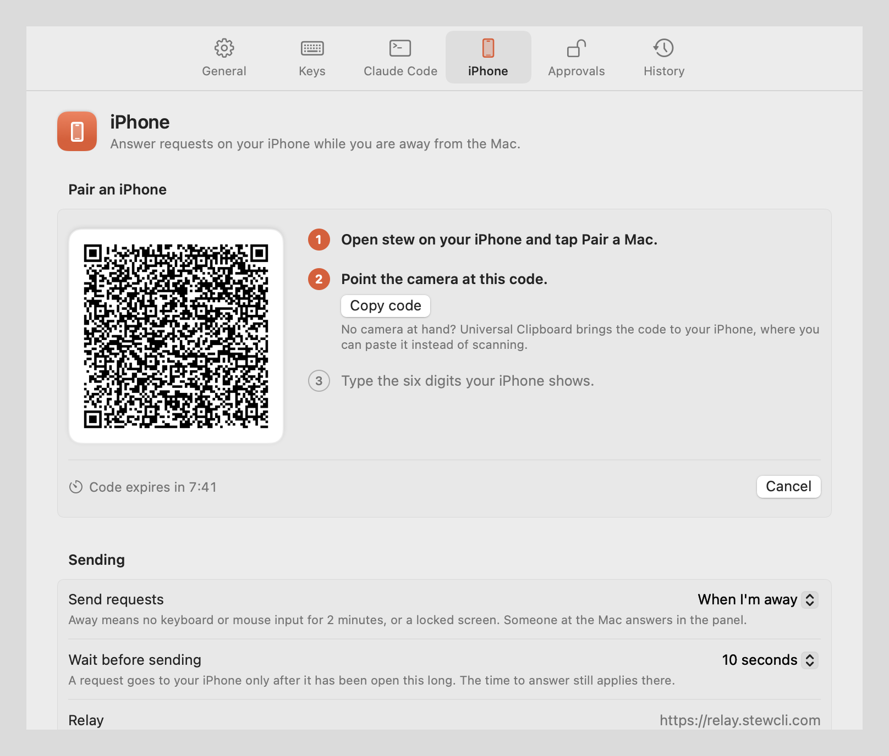
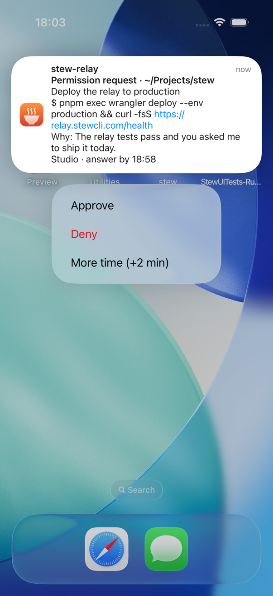

# stew on your iPhone

When a request stays open while you are away from your Mac, stew sends it to your iPhone as a notification you can answer. The answer goes back to the Mac, and Claude gets it as if you had answered in the panel.

## How it behaves

- **When it pushes.** A request goes to the phone once it has been open 10 seconds (`phone.after`) and the Mac is idle (no keyboard or mouse input for 2 minutes, `phone.idleAfter`) or its screen is locked. Settings ▸ iPhone ▸ Send requests offers "When I'm away" (the default), "Always" and "Never" (`phone.push`: `away`, `always`, `never`).
- **The time limit still applies.** The notification shows when the time to answer runs out. An answer that arrives later is refused, and the phone says so. More time on the phone adds the same time as ⌘E on the Mac.
- **First answer wins.** When the request is answered anywhere (Mac, phone or another phone), times out or is dismissed, the other devices remove their notification.
- **Hard denies stay on the Mac.** A call auto mode never allows can be approved on the Mac only. The phone shows it and offers Deny and More time, but no Approve.
- **Approve needs an unlocked phone.** On a locked phone the Approve action asks for Face ID or the passcode first. On an unlocked phone, and on the Watch while it is unlocked on your wrist, iOS does not ask again. Approve in the app always asks. Deny and More time never ask.
- **Risk check first.** A request waits while its risk check runs, so the phone sees the verdict and a hard deny never arrives with an Approve.
- **Questions.** A single question offers its options (up to 4) and "Other…" with a text field. Several questions, or a multi-select question, open the app.
- **Notifications** (`stew notify`) arrive without actions.
- **Needs items** (`stew needs`) go out once they have been open 10 seconds, also while you are at the Mac, because they have no deadline and the task often takes you away from the desk. "Never" still sends none. The notification shows the title, why, the steps and the commands with secrets masked, with Done and Not now. When Claude named the Done button (`--done`) or offered other answers (`--answer`), the actions carry those labels: Done with its label, each other answer, then Not now, in a notification category made for that item. Done and the other answers need no Face ID; Done ends the item on the Mac as Done, another answer ends it as Answered, and Claude learns which label was picked. The Mac takes an answer only when the item offers that label, so an answer from a stale or forged notification is refused. Done keeps its old form on the wire, so an iPhone app from before the labels still ends such an item with Done. Not now only clears the notification; the item stays open on the Mac. An item you parked with Not now on the Mac is not sent. The phone's history uses the Mac's labels: Done, Dismissed, Resolved by Claude, Answered in session, Moved on.
- **Apple Watch** shows the same actions, without a watch app.

## Pairing

1. On the Mac: Settings ▸ iPhone ▸ Pair an iPhone. stew shows a QR code. The same code is a `stew://pair?code=…` link that you can copy and paste on the phone instead. The code works for 10 minutes and for one phone; a copied code leaves the clipboard after a minute.
2. On the iPhone: in the stew app, tap Pair a Mac and scan the code, or paste it.
3. The iPhone shows six digits. Type them on the Mac. The Mac never shows them, so they can only come from your phone. If the phone shows none (another device used the code first), reject on the Mac.



A Mac can pair with several phones and a phone with several Macs. Each pairing has its own id, its own pairing secret and its own key. Unpairing on either side removes the pairing on both.

## Configuration

The `phone` object in `~/.config/stew/config.json`. Every field is optional.

```json
{ "phone": { "push": "away", "after": 10, "idleAfter": 120, "relay": "https://relay.stewcli.com" } }
```

- `push`: `away`, `always` or `never`. An unknown value counts as `away`.
- `after`: seconds a request must be open before it is sent.
- `idleAfter`: seconds without keyboard or mouse input before the Mac counts as away.
- `relay`: the relay for new pairings. Each pairing keeps the relay it was made with, so change this before pairing. [relay/README.md](../relay/README.md) explains self-hosting.

## Testing

```bash
swift test              # StewLink: encryption, signatures, replays, expiry, notification text, history
Tests/phone/run.sh      # a local relay in MOCK_APNS mode, a headless daemon and a test phone
```

`Tests/phone/run.sh` needs the relay's dependencies (`pnpm install` in `relay/`) and runs everything on this Mac: the relay records pushes instead of sending them to Apple, and `stew-test-phone` decrypts them with the same code as the iOS app and answers.

## iPhone app

The app is in `ios/App`: the app (`nl.koode.stew.ios`), its notification service extension, unit tests and a UI test target that takes screenshots. It uses the `StewLink` package from the repository root for every message, key and sentence, so the phone and the Mac say the same thing.



Needs items show the same parts as the Mac panel: the title, Why, the steps, the commands with secrets masked, and the links. Done (with Claude's label for it) and the other answers tell Claude how to go on and ask for no Face ID, because they run nothing. Not now sends nothing: the notification goes, and the item stays in Requests and on the Mac. Needs items have no time limit, so they never show as missed.


### Building

The Xcode project is generated from `ios/App/project.yml` and is not committed.

```bash
brew install xcodegen
cd ios/App && xcodegen generate
xcodebuild build -project Stew.xcodeproj -scheme Stew -destination 'platform=iOS Simulator,name=iPhone 17 Pro'
```

`ios/tools/testflight.sh` archives a release build and uploads it to TestFlight with the App Store Connect API key. Debug builds register with the relay as `sandbox`, release builds as `production`.

### Testing

```bash
cd ios/App
xcodebuild test -project Stew.xcodeproj -scheme Stew -destination 'platform=iOS Simulator,name=iPhone 17 Pro' -only-testing:StewTests
```

The unit tests seal real envelopes with a fake Mac's keys and answer through a stubbed relay. `StewUITests` is a screenshot harness, not a gate.

On the simulator, debug builds take three launch arguments. None of them exist in release builds.

- `-StewSeed <base64>` installs the phone state that `stew-test-phone sample-push --out DIR` writes to `DIR/seed.txt`, without a relay.
- `-StewDeliver <base64>` runs a push payload (`base64 -i DIR/push-permission.json`) through the notification extension's code in the app and shows the result 15 seconds later. `xcrun simctl push` delivers payloads, but the simulator does not start notification service extensions for them, so this is how to see a decrypted notification there.
- `-StewDemo [requests|request|question|needs|history|macs]` shows sample requests and history on that screen, for screenshots.

### Screenshots

`StewUITests/ScreenShots/testNotification` launches the app with `TEST_RUNNER_STEW_SEED` and `TEST_RUNNER_STEW_PUSH`, goes to the Home Screen, and captures the banner and the expanded notification. Export them with `xcrun xcresulttool export attachments`. The app screens come from `-StewDemo` and `xcrun simctl io <device> screenshot`. A headless simulator applies `xcrun simctl ui <device> appearance dark` only after a reboot.

## Security

- **End to end.** Every message is encrypted with ChaCha20-Poly1305 and signed with the sender's Ed25519 key. The key comes from HKDF-SHA256 over the X25519 shared secret of the two devices, salted with the 32 byte pairing secret from the QR code.
- **What the relay sees.** The pairing id, the phone's push token, the public keys, and for each message: its kind (request, update, resolved, answer, result, hello, unpair), the sender side (mac or phone), the request id, the message id and the expiry. It never sees the session, the command, the question or the answer. Plaintext is padded to 256 byte blocks, so message sizes do not tell approve from deny. Message order still shows one thing: More time is followed by an update, a final answer by a resolved message.
- **What the relay cannot do.** It cannot read or forge a request or an answer: it does not have the pairing secret, so it cannot derive the key, and it does not have the private signing keys. A relay that swapped in its own keys during pairing would fail on the encryption, and the six digits would not match. A relay that holds an answer back cannot apply it later: the Mac refuses answers more than 30 seconds old.
- **Replays.** Each message has a unique id and an expiry. The receiver refuses expired messages and message ids it has already seen, and the Mac takes only the first answer to a request. The Mac keeps seen ids in memory only; request ids are new each run, so an answer from before a restart finds nothing to answer.
- **Keys.** On the Mac, the private keys and pairing records are in the login keychain (service `nl.koode.stew.link`). On the iPhone they are in the app group keychain shared by the app and its notification extension.
- **No self-approval.** A phone counts only after the user types its digits on the Mac. A process on the Mac that took a copied code and registered first gets no further: the real phone shows no digits, so there is nothing to type. Pairing through the socket exists only in the headless test daemon.

## Wire protocol

This section is the contract between the Mac, the relay and the phone. Swift types are in `Sources/StewLink`.

### Encodings

- JSON bodies carry binary fields (keys, ciphertext, signatures) as standard base64 with padding.
- Query strings carry signatures as base64url without padding.
- Ids (pairing, request, message) are 1 to 64 characters of `A-Z a-z 0-9 - _`.
- Times on the wire are Unix seconds.

### Envelope

```json
{ "v": 1, "pairingId": "…", "kind": "request", "sender": "mac", "requestId": "…",
  "messageId": "…", "replyTo": "", "expiresAt": 1800000000,
  "ciphertext": "<base64>", "signature": "<base64>" }
```

- `kind`: `hello`, `request`, `update`, `resolved`, `answer`, `result`, `unpair`.
- `sender`: `mac` or `phone`.
- `requestId`: the request the message is about; `pairing` for hello and unpair.
- `replyTo`: for a result, the message id of the answer it replies to; empty otherwise.
- `ciphertext`: ChaCha20-Poly1305 combined box (12 byte nonce, ciphertext, 16 byte tag). The associated data is the header below.
- Header: the lines `stew-link/1`, pairingId, kind, sender, requestId, messageId, replyTo, expiresAt, joined with `\n`.
- `signature`: Ed25519 over the header, `\n`, and the ciphertext as the same base64 text the JSON carries.

### Relay endpoints

All paths start with `/v1/pairings/{pairingId}`. The relay keeps one Durable Object per pairing id. Signed GET requests carry `?ts=<unix seconds>&sig=<base64url>`; the relay refuses a timestamp more than 300 seconds from its clock.

| Method and path | Caller | Body or auth | Result |
|---|---|---|---|
| `POST /claim` | Mac | `{macSigningKey, registrationTokenHash, timestamp, signature}`, signed text `stew-link/1 claim\n{id}\n{hash}\n{ts}` | 201 claimed, 200 already this Mac's, 409 another key holds it |
| `POST /device` | phone, first time | `{registrationToken, deviceToken, environment, phoneKeys, hello}` | 201; 403 wrong token; 409 already used |
| `POST /device` | phone, later | `{deviceToken, environment, timestamp, signature}`, signed text `stew-link/1 device\n{id}\n{deviceToken}\n{environment}\n{ts}` | 200 |
| `GET /socket` | Mac | WebSocket; signed text `stew-link/1 socket\n{id}\n{ts}` | frames to the Mac |
| `POST /messages` | either | an envelope | see below |
| `GET /pending` | phone | signed text `stew-link/1 pending\n{id}\n{ts}` | `{requests: [envelope], resolved: [envelope]}` |
| `GET /v1/test/pushes/{pairingId}` | tests | only with `MOCK_APNS=1` | `{pushes: [{at, host, path, headers, payload}]}` |

- `registrationTokenHash` is the lowercase hex SHA-256 of the registration token's UTF-8 text. The token is base64url of HKDF-SHA256 over the pairing secret with info `stew-link/1 registration`. The relay deletes the hash once a phone has registered, so a code pairs one phone.
- `environment` is `production` or `sandbox` and picks the APNs host.
- The hello envelope must be signed by `phoneKeys.signing`. The relay passes it on to the Mac as `{"type":"hello","envelope":…,"phoneKeys":…}`.
- The relay stores the hello frame and a phone's `unpair` frame until the Mac acknowledges them with `{"type":"ack","messageId":"<the envelope's messageId>"}` on its socket, or until the envelope expires. It sends every unacknowledged frame, oldest first, each time the Mac connects, so the Mac can receive one more than once. Acks count only on the Mac's socket; an ack for an unknown id is ignored. Answers need no ack, because their result comes back in the same exchange.

`POST /messages` checks the envelope's fields, that its pairing id matches the path, its expiry (not past, at most 7 days ahead), its signature against the stored key of the sender, that its message id is new, and the pairing's rate limit (429 with Retry-After). Then:

| Sender and kind | What the relay does |
|---|---|
| mac `request` | Stores it as pending, sends an alert push. 202, or 409 `no_device` |
| mac `update` | Replaces the pending copy, sends a background push. 202 |
| mac `resolved` | Drops the pending copy, keeps the envelope for an hour, sends a background push. 202 |
| mac `result` | Hands it to the phone's waiting answer with that `replyTo`. 202 |
| mac `unpair` | Sends a background push, then deletes the pairing. 202 |
| phone `answer` | Sends `{"type":"envelope","envelope":…}` on the Mac's socket and waits up to 10 seconds for the result. 200 `{result: envelope}`, 503 `mac_offline`, 504 `mac_timeout` |
| phone `unpair` | Passes it on to the Mac (queued if it is offline), then deletes the phone's data. 202 |

### Pushes

The relay signs an ES256 JWT with the APNs key (`APNS_KEY`, `APNS_KEY_ID`, `APNS_TEAM_ID`) and posts to `https://api.push.apple.com/3/device/{token}` (`api.sandbox.push.apple.com` for sandbox tokens) with topic `APNS_TOPIC`.

Alert push, for `request`:

```json
{ "aps": { "alert": { "title": "stew", "body": "A request is waiting on your Mac." },
           "mutable-content": 1, "sound": "default", "thread-id": "<pairingId>" },
  "stew": { "pairingId": "…", "requestId": "…", "kind": "request", "envelope": { … } } }
```

Headers: `apns-push-type: alert`, `apns-priority: 10`, `apns-expiration: <expiresAt>`, `apns-collapse-id: <requestId>`. When the payload would exceed 4 KB, `envelope` is left out and the notification extension fetches it from `GET /pending`.

Background push, for `update`, `resolved` and `unpair`: `{"aps":{"content-available":1},"stew":{…}}` with `apns-push-type: background` and `apns-priority: 5`.

The notification extension decrypts the envelope and replaces the generic text with the request itself. If it cannot, the generic text stays.
